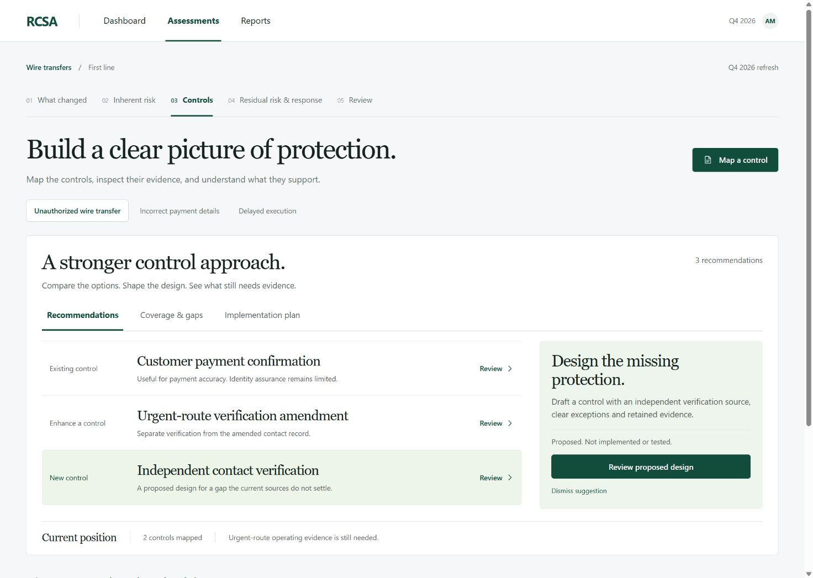
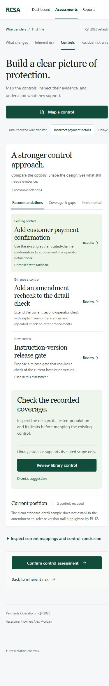
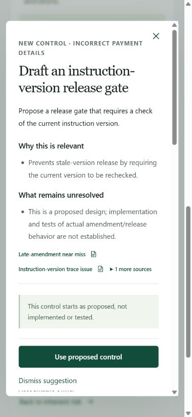
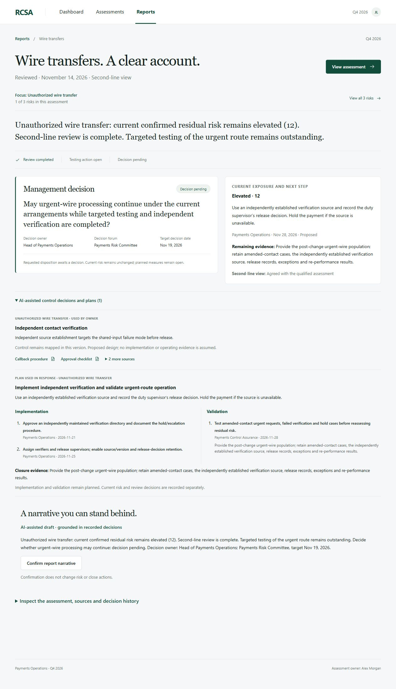

# Control assistance implementation and verification

**Date:** November 14, 2026  
**Scope:** AI-01 through AI-04, phase 1 of the [AI capability expansion plan](../operations/ai-capability-expansion-plan.md). The remaining phases are planned.

## Implemented experience

Controls now begins with a contextual assistant. Suggest controls prepares three distinct approaches for each of the three current risks: an existing control, an enhancement and a new design. The owner can compare source-backed relevance/limits, dismiss with a reason, or edit and use a proposal. New and enhanced designs retain operational fields and proposed status. Enhancements preserve the existing implemented definition rather than rewrite it.

Coverage and gaps responds to mappings and proposed designs. It distinguishes intended design response, shared inputs, implementation and operating evidence. Preliminary conclusions can be used explicitly. Check my conclusion handles bounded evidence-scope claims and returns unknown for wording outside the prepared checks; it is not a live semantic evaluator.

The assistant generates an editable implementation and validation plan from the selected approach. Task editors use native description, owner, date and evidence fields with add/remove controls. Using a plan fills the existing response draft; the owner then records the risk response. Decisions, task plans and source references appear in owner review, second-line review, reports and immutable submitted versions.

Plans retain their control-basis signature. Mapping, conclusion or new-evidence changes flag them for review. An obsolete active plan blocks submission until updated or explicitly detached. Detachment archives its tasks and leaves the owner's response text available for review. Edits made in the response editor are retained when reopening the linked plan.

## Verification results

All ten model/render checks passed on the final implementation:

- `verify-demo.mjs`
- `verify-product-refinements.mjs`
- `verify-owner-revision.mjs`
- `verify-mapping-applicability.mjs`
- `verify-risk-intelligence.mjs`
- `verify-risk-matrix.mjs`
- `verify-persona-fixes.mjs`
- `verify-report-refinement.mjs`
- `verify-control-assistance.mjs`
- `verify-control-assistance-workflow.mjs`

The new checks cover distinct risk recommendations, source references, complete design fields, proposal incorporation, mapping-dependent gaps, valid task dates/evidence, plan preview/edit preservation, stale plans, explicit detachment, role guards, unchanged confirmed ratings and immutable submission snapshots. Independent source review found three consistency issues during implementation; response/plan synchronization, stale-plan submission and mapped-design inspection were fixed and independently rechecked.

## Browser replay

The in-app browser was used throughout; no external browser automation fallback was required.

1. Open Controls and choose Suggest controls. Compare the three unauthorized-wire approaches and inspect the proposed design.
2. Edit the design and explicitly assess its expected coverage. Use it; inspect the changed gap findings and continued operating-evidence limitation.
3. Use a qualified conclusion draft. Generate the linked plan and verify it uses the edited design. Edit an implementation task, add/remove a validation task and use the plan in the response.
4. Edit protection in the response, then reopen the linked plan. Confirm the latest response wording and edited tasks remain intact. Record the response.
5. Confirm scope, inherent risk, control assessment, shared-source judgment and residual assessment. Attest and submit version 1.
6. Switch to second line, inspect the generated tasks and send a challenge. The owner drafts a reply and renews attestation, producing version 2. Second line records agreement with the qualified assessment.
7. Open the reviewed report. Confirm current residual risk remains Elevated 12, implementation/testing remain open and management disposition remains pending. The edited implementation task and revised protection appear in the plan record.
8. Inspect the mapped proposed design as reviewer. It shows the owner's actual edited design; incorporation is disabled.
9. In a fresh tab, select Incorrect payment details. Edit and map the instruction-version design, dismiss a different recommendation with rationale and reload. Both decisions and the edited design persist.
10. At 390×844, inspect recommendations and the proposed-design dialog. No document or dialog horizontal overflow was detected. Recommendation rows and inspector stack. The confirmation footer was changed to normal document flow after it initially overlaid mobile content.
11. Use the keyboard to open the proposal and Escape to close it. Focus returns to Review proposed design. No browser console errors were recorded during the exercised flows.

The default desktop width, the concept's 1487×1058 reference viewport and 390×844 mobile were checked. Temporary viewport overrides were reset. The pre-existing local preview was reused; no hosted resources or paid environments were created.

## Design comparison

The [generated concept](concepts/ai-control-assistance/controls-assistant-concept.png) extends the existing approved visual system. The built-in Image Gen tool used the prior Controls screenshot as reference. [Prompt and implementation notes](concepts/ai-control-assistance/prompts.md) retain the design brief. The concept and final native-size screenshot were both opened with `view_image` in the same comparison pass.

| Comparison point | Result and intentional adaptation |
| --- | --- |
| Navigation and context | Existing RCSA navigation, risk selector and five assessment stages retained. No additional destination or chatbot was introduced. |
| Main layout | Full-width assistance surface, ruled recommendation rows and right-hand inspector match the concept. Current mappings and owner conclusion remain accessible beneath it. |
| Typography | Georgia headings and system-sans UI follow the existing tokens. Shortened display titles remove unnecessary action prefixes and match the concept. Existing shell font sizes/spacing are retained rather than adopting generated-image text metrics. |
| Palette and surfaces | Existing light background, white panel, forest actions, pale-green selection, thin borders and restrained radii are preserved. |
| Copy and actions | Heading, description, three tabs and flagship display titles follow the concept. Dismissal, source inspection and native task editing are functional additions required by the plan. The existing Map a control icon is retained. |
| Sources and density | Source links show two references plus an expandable remainder. Coverage/plan detail extends the same component family without decorative metric cards. |
| Responsive and focus behavior | Mobile stacks rows/inspector and bounds dialogs. The overlaying sticky footer and a lower-case title artifact were fixed. Keyboard return focus was verified. |

Above-the-fold copy was compared with the concept. Differences are the existing shell metrics, required functional dismissal control and scroll position of the mapping disclosure; these are intentional adaptations to the established app. No unresolved clipping, overlap or horizontal overflow was found in the checked states. The implemented extension was visually verified against the reference and existing system; this is not a claim of pixel-identical generated typography or a complete accessibility audit.

## Rendered evidence

The demonstration remains local and scripted. This verification establishes the supported interactions and state transitions, not live model quality, actual control operation or external service integration. The terminal browser regression was updated for the new recommendation entry point; browser execution in this task used the in-app controls and the replay above.
