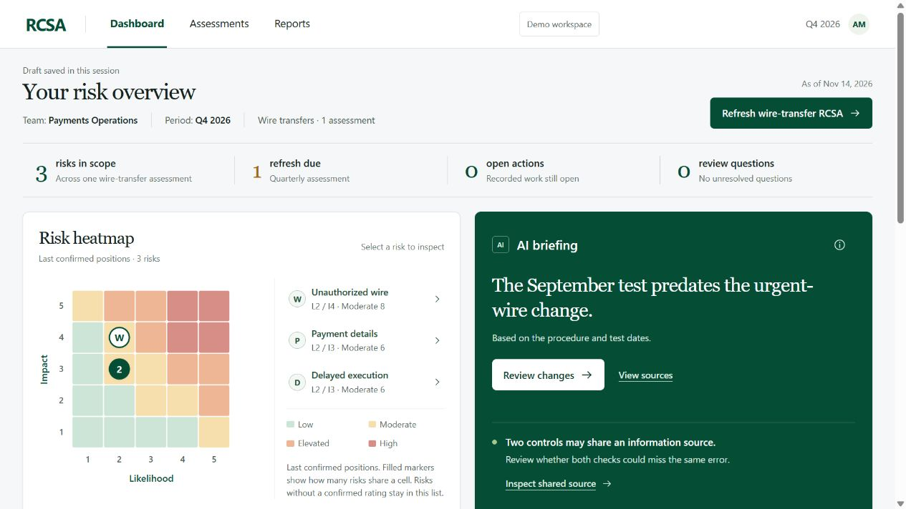
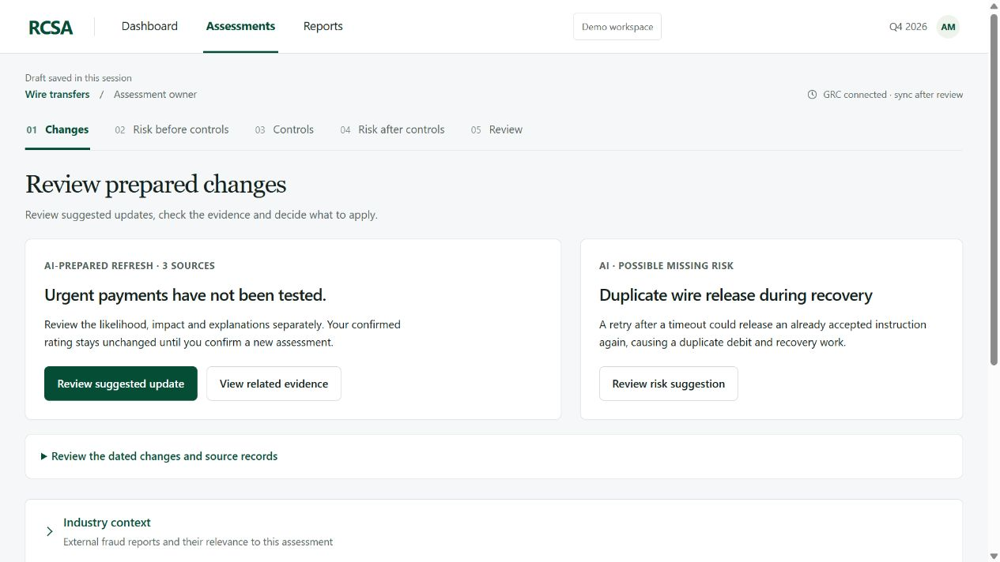
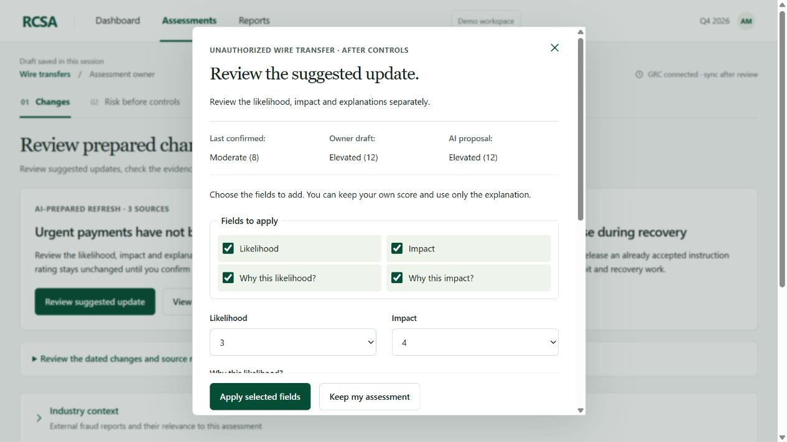
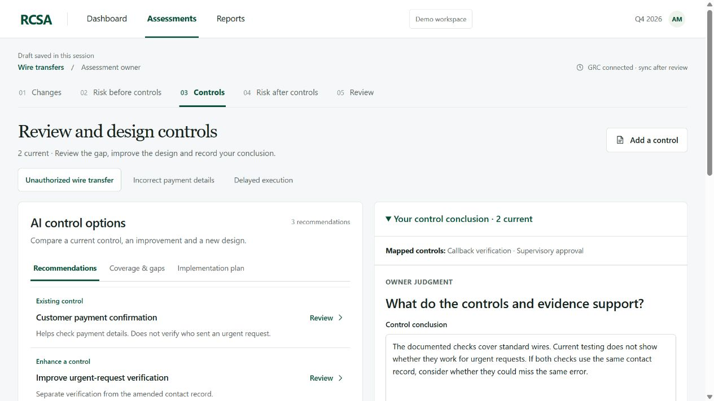
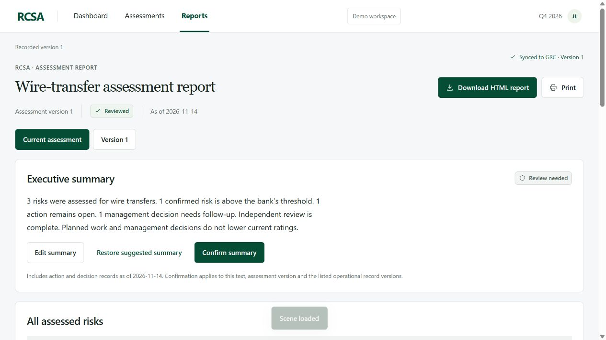
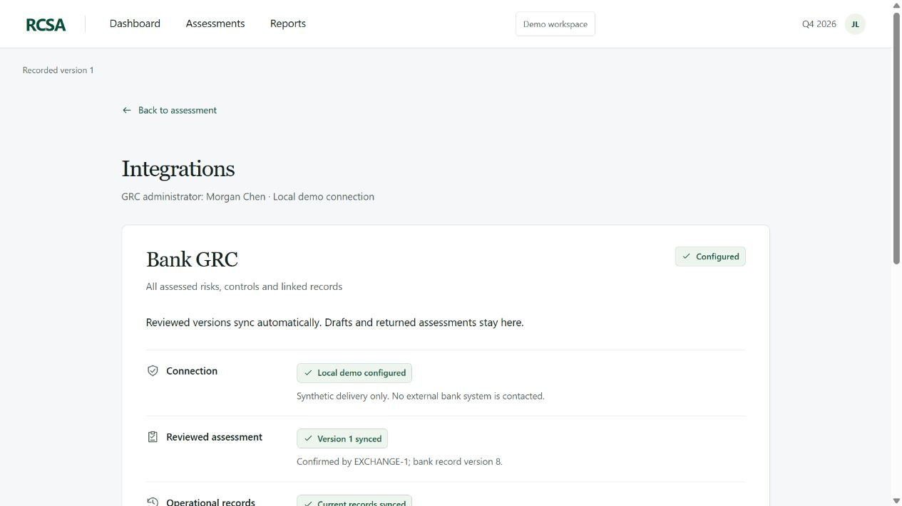

# Banking leader demo roleplay review

November 15, 2026. Review of the local demo, source version `20261115.11`.

Follow-up: the owner-selected AI approval, bank setup, language and demo-flow changes are [implemented and verified](../operations/client-demo-upgrade-2026-11-15.md). This review records the earlier state. The owner deferred sync demonstrations and enterprise rollups.

The demo credibly shows an evidence-led RCSA refresh for one wire-transfer process. Its strongest moments are inspecting test scope, identifying possible shared control information, preserving human judgment, and keeping assessment review, management decisions and assurance closure separate. Its largest gap is proving that the experience can fit a bank's own policies and infrastructure. Editable assessment content is already visible; bank policy administration is not.

This review used a sub-agent roleplaying Ethan and a skeptical banking leader, source-code checks, and a fresh browser inspection in an isolated tab. The roleplay below is a proposed nine-minute script, not a measured rehearsal or feedback from a real banking customer. No app behavior was changed. Existing user drafts were preserved.

## Findings to address before the next banking demo

### 1. The bank customization claim exceeds the demonstrated setup

**Banker:** “We use four levels, different impact dimensions and a different approval policy. Where do I put ours?”

The app fixes five likelihood and impact levels, multiplication, band boundaries and a tolerance of 9. Integrations can map bank record identifiers and demonstrate a method mismatch. It does not configure another assessment method. Selecting the compatible five-point exchange profile is not a general methodology builder. Approval perspectives and named actors are also prepared.

**Type:** Highest-impact buyer capability gap. A fixed example method is reasonable for a demo; it does not prove bank-specific configuration.

**What to say today:** “This example uses one preconfigured method. You can edit assessment content, control designs, relationships and follow-up work. Administration of your methodology and approval rules is still to build.”

**Recommended repair:** Add a versioned bank profile that drives the actual forms, matrix, definitions, thresholds, required evidence and approval routing. Demonstrate two distinct synthetic profiles and preserve the selected policy version with submitted assessments. Keep setup in an administrator area; show a short profile summary and a details button in the assessment. Changing a profile must not silently convert or rewrite earlier ratings.

**Acceptance:** A presenter can change a policy in one place and demonstrate its effect on scoring and required decisions without editing code. An incompatible integration method remains visibly blocked until an agreed mapping exists.

Evidence: [model.js:6](../../src/scripts/demo/model.js#L6), [model.js:17](../../src/scripts/demo/model.js#L17), [grc-exchange.js:5](../../src/scripts/demo/grc-exchange.js#L5), [grc-exchange.js:24](../../src/scripts/demo/grc-exchange.js#L24). Browser step 6.

### 2. The testing headline is stronger than the supporting evidence

**Banker:** “How do you know nobody tested urgent payments? Perhaps that test is in another system.”

Changes says “Urgent payments have not been tested.” The linked WT-25 record establishes that the available sample covered standard wires before the October change. That record does not establish a complete inventory of subsequent testing. The dashboard's narrower statement about the test predating the change is more defensible.

**Type:** High-impact wording and evidence interpretation issue.

**Recommended repair:** Use “The available test does not cover urgent payments.” Keep the excluded population, test date and procedure change one click away. Distinguish evidence missing from the app, evidence outside scope, and a confirmed control failure.

The adjacent **View related evidence** button opens the first source, the procedure, rather than the test behind the headline. Open WT-25 directly or offer a small source list identifying what each record supports.

**What to say today:** “We do not have supporting urgent-route test evidence in this example. That is a question to resolve, rather than proof that the control failed.”

Evidence: [upgrade-view.js:11](../../src/scripts/demo/upgrade-view.js#L11), [workflow-demo.json:197](../../assets/data/workflow-demo.json#L197). Browser steps 1–2.

### 3. The starting draft obscures what the AI contributes

**Banker:** “Did the AI just move the score from 8 to 12, or was 12 already there?”

The initial owner draft is already 12; the last confirmed rating is 8; the prepared AI proposal is also 12. The proposal clearly labels the three values, but accepting its score can appear to do nothing. This is a presentation issue as well as a limitation of prepared output.

**Type:** High-impact AI demonstration and provenance issue.

**Recommended repair:** Make the initial state explicit: “Prepared draft awaiting owner review,” with its origin and date. Alternatively, start a coherent scenario from the previous confirmed values and let applying the prepared proposal create a visible draft change. Never replace the confirmed position merely by opening or applying a suggestion.

**What to show today:** Use selected explanation fields, edit the wording and retain a different owner score. Explain the evidence comparison and time saved in drafting, without implying a live model calculated a measured probability.

Evidence: [model.js:21](../../src/scripts/demo/model.js#L21), [upgrade-model.js:15](../../src/scripts/demo/upgrade-model.js#L15). Browser step 3.

### 4. Generic AI and live integration claims will fail a follow-up question

**Banker:** “Use our own process and policy. Which documents will it read? Which GRC did that update?”

The app uses authored suggestions and synthetic evidence. Materially changing the supported risk scope can make prepared assistance unavailable, correctly avoiding unrelated recommendations. Users can continue manually. The GRC exchange and role perspectives run locally; there is no live bank connector, model service, SSO or shared production authorization. Session storage is local to the tab.

The Integrations screen clearly says this. Shared assessment/report status text such as “GRC connected” and “Synced to GRC” loses that qualification when seen on its own.

**Type:** High-impact capability boundary; status wording is a small repair, production services are pilot work.

**Recommended repair:** Use “Demo GRC configured” and “Demo GRC updated” in shared status text. Keep a concise demo disclosure available. Provide a pilot architecture view covering evidence sources, system of record, permissions, field ownership, hosting, model/data handling, retention and support. Describe planned capabilities as planned until implemented.

**What to say today:** “The prototype demonstrates the decisions and exchange behavior. Live analysis, identity enforcement and your connector would be implemented and verified for a pilot.” Editing a control design demonstrates content customization; it does not prove arbitrary bank-document analysis.

Evidence: [README.md:5](../../README.md#L5), [README.md:31](../../README.md#L31), [upgrade-model.js:23](../../src/scripts/demo/upgrade-model.js#L23), [upgrade-model.js:49](../../src/scripts/demo/upgrade-model.js#L49), [grc-view.js:49](../../src/scripts/demo/grc-view.js#L49). Browser steps 4 and 6.

### 5. Prepared baseline confirmations lack an obvious origin

**Banker:** “Who assessed the other two risks? When did they confirm them?”

Payment-details and cutoff risks start confirmed while the initial local history is empty. This keeps the flagship story focused, but a banker examining the complete register may reasonably ask where those confirmations came from. Supporting sample records exist; baseline provenance needs to be equally clear.

**Type:** Medium-impact demo data and record credibility issue.

**Recommended repair:** Mark imported or prepared baseline assessments and preserve their example assessor, date, method version and source references. Do not invent events in the current session history. When new intelligence calls a baseline into question, make the unresolved qualification visible before submission and verify the required owner acknowledgment.

**What to say today:** “Those are prepared example assessments. We are refreshing the first risk; let's inspect a supporting qualification on another one.”

Evidence: [model.js:20](../../src/scripts/demo/model.js#L20), [model.js:25](../../src/scripts/demo/model.js#L25). Browser steps 1 and 5.

### 6. Report statuses describe different decisions using the same word

**Banker:** “Is it reviewed or does it still need review?”

The report header says **Reviewed**, while the executive summary says **Review needed**. The latter is a separate summary confirmation, not the assessment's independent review. The separate control is useful, but its label forces explanation. Some perspectives can see the label without having the summary controls.

**Type:** Medium-impact status and ownership friction.

**Recommended repair:** Use **Assessment reviewed** and **Summary needs confirmation**. Name the responsible role when the viewer cannot act. Keep the summary's included operational versions and confirmation separate from the assessment review.

**What to do today:** Confirm the summary from the owner or reviewer perspective before the executive report moment. Do not imply that assessment review approves management acceptance or closes actions.

Evidence: [reports.js:65](../../src/scripts/demo/reports.js#L65). Browser step 5.

### 7. One process is not yet a bank portfolio

**Banker:** “Can I see our business units, legal entities, processes and assessment owners?”

The dashboard is candidly scoped to one wire-transfer assessment and three initial risks. It is a good process view. It does not demonstrate a bank-wide assessment inventory, organizational hierarchy, taxonomy administration or rollups. The assessment scope description also states that settlement-service infrastructure is assessed separately, without demonstrating navigation to that assessment.

**Type:** Medium-impact enterprise capability gap.

**Recommended repair:** Add a small, coherent synthetic assessment inventory and links between related process and technology assessments. Show how bank taxonomy, ownership and aggregation policy fit. Avoid populating decorative portfolio charts without underlying records and drill-downs.

**What to say today:** “This is the Payments Operations process view. Enterprise inventory and rollup behavior are not demonstrated here.”

Evidence: [assessment.js:45](../../src/scripts/demo/assessment.js#L45), [dashboard.js](../../src/scripts/demo/dashboard.js). Browser step 1.

### 8. Control rigor exists, but bank-specific evaluation needs proof

**Banker:** “How do we record design effectiveness, operating effectiveness and our test requirements?”

The app distinguishes documented design, operation, test population and dates, combined coverage, proposed controls and assurance closure. Those are substantive strengths. Current judgments and evidence remain largely authored text, and the demo does not prove configurable control grading, testing standards or policy-specific minimum evidence.

**Type:** Medium-impact configuration and demonstration gap, not a finding that the workflow has no control assessment.

**Recommended repair:** Within control details, show the bank's required evaluation fields, conclusion, assessor, test period/population, exceptions, source versions and next review. Allow bank-specific evaluation criteria through the policy profile. Keep the main screen to a short conclusion and evidence status; put the detail behind inspection controls.

**What to show today:** Inspect one current control's design and test scope. Show one proposed design and explain why it does not count as current protection. Show the shared-source suggestion as a question requiring owner judgment.

Evidence: [controls.js:26](../../src/scripts/demo/controls.js#L26), [controls.js:50](../../src/scripts/demo/controls.js#L50), [workflow-demo.json:95](../../assets/data/workflow-demo.json#L95). Browser step 4.

### 9. Detail can interrupt a simple executive story

**Banker:** “What changed, what decision do you need, and who is doing the work?”

At the captured viewport, the proposal modal shows the three rating states and field-selection checkboxes before its rationale and sources, which require inner scrolling. Controls also has multiple detail sections below the fold. Essential rigor is present, but a presenter can spend the meeting navigating forms rather than explaining decisions.

**Type:** Medium-impact flow and presentation friction.

**Recommended repair:** Give the proposal a short evidence-backed explanation near the top, with field-level edits and technical details on demand. Keep the primary demo to one risk, one useful suggestion, one control decision, one response, one independent review and one report. Retain required decisions; reduce repeated prose and unnecessary expansion. Optional branches should answer a buyer question.

**What to do today:** Explain each decision before opening its details. Do not demonstrate risk discovery, every response strategy, reviewer questions, action returns, expiry and sync faults in the opening nine minutes.

Evidence: Browser steps 3–4 and the [current runbook](../operations/demo-runbook.md).

## RCSA practice benchmark

The Basel operational-risk guidance describes assessment of inherent risk, control effectiveness and residual exposure, with enough explanation for independent review. It also addresses testing, risk appetite and remediation. These principles support the app's separation of evidence, judgment and follow-up. They do not prescribe this demo's five-point matrix or a universal threshold of 9. See [Basel ORR 10, particularly 10.32–10.45](https://www.bis.org/committees/bcbs/basel-consolidated-guidelines/module/orr/10).

For a US banking example, the OCC says governance should fit the bank's size, complexity and risk profile. That reinforces the customization question; it does not certify this prototype or impose one workflow on every institution. See the [OCC Corporate and Risk Governance handbook, introduction](https://www.occ.treas.gov/publications-and-resources/publications/comptrollers-handbook/files/corporate-risk-governance/pub-ch-corporate-risk.pdf).

The judgment from this review is that the demonstrated RCSA sequence is directionally sound. Bank-specific policy fit, production controls and operating effectiveness still require implementation and validation with the target institution.

## Proposed nine minute roleplay

| Time | Presenter action | Likely banker interruption | Accurate response |
| --- | --- | --- | --- |
| 0:00–0:40 | Introduce a working prototype with synthetic records and prepared suggestions. | “Is it connected to our systems?” | “The exchange is simulated locally. Your connector, hosting and permissions would be implemented for a pilot.” |
| 0:40–1:40 | Show the process dashboard, confirmed heatmap and work queue. | “Is the risk 8 or 12?” | “Eight is last confirmed. Twelve is the prepared draft under review.” |
| 1:40–2:50 | Inspect WT-25 and the dated procedure; review selected explanation fields. | “How do you know urgent testing wasn't done elsewhere?” | “The available test does not cover that route. We need the relevant evidence.” |
| 2:50–4:15 | Inspect a current control, proposed improvement and possible shared source. | “Two people approve it. Why isn't that enough?” | “They could use the same incorrect information. The owner confirms or qualifies that relationship.” |
| 4:15–5:30 | Assess residual risk and record change and testing work. | “Does adding the control reduce the rating?” | “A proposed design is not current protection. Reassessment needs supporting evidence.” |
| 5:30–6:40 | Show the submission and independent review. Explain the perspective switch. | “Has management now accepted the risk?” | “The reviewer agrees with the assessment. Management's decision about continuing activity is separate.” |
| 6:40–7:35 | Show the linked action and management request; identify owners and next decisions. | “Can the person doing the work close it?” | “This workflow uses assurance to review closure evidence. Production identity enforcement is still to implement.” |
| 7:35–9:00 | Confirm the summary, inspect the reviewed report and explain simulated sync. | “Can we use our policy?” | “Content is editable today. Your scoring definitions, thresholds and approval structure need the configuration capability described here.” |

Keep adding a new risk, reviewer questions, action closure, expiry and integration recovery as optional branches. These are useful depth, but they compete with the opening story if all shown at once.

## Verified screens and visual notes

These six screenshots were captured fresh in this review, saved and opened for inspection. The completed-review screen was reached through the explicit presentation scene shortcut. This was a focused browser inspection, not an uninterrupted timed completion of the full workflow.

| Step | Screen | Health | Notes |
| --- | --- | --- | --- |
| 1 | Dashboard | Clear process view | Last-confirmed positions and a source-led briefing work well. One assessment is explicit. |
| 2 | Changes | Clear layout, claim needs repair | Cards now have readable spacing. The test headline overstates the visible evidence. |
| 3 | Proposal | Sound state separation, reading friction | Prior, owner and AI values are explicit. Explanations and sources sit below the initially visible modal content. |
| 4 | Controls | Strong substance, substantial depth | Proposed design and current protection remain separate. Control evaluation needs a brief presenter path. |
| 5 | Reports | Useful output, ambiguous labels | Assessment review and summary confirmation need distinct names. |
| 6 | Integrations | Honest details, limited configuration | Local simulation is explicit here; shared status text should carry the same meaning. |

### Step 1 Dashboard

### Step 2 Changes

### Step 3 Proposal

### Step 4 Controls

### Step 5 Reports

### Step 6 Integrations

This review did not establish screen-reader compatibility, full keyboard operation, responsive behavior at every breakpoint, production access control, live model quality or live connector correctness. Those claims require separate verification. No new images or dynamic AI-generated visuals are recommended; the proposed visual work concerns permanent policy, status, evidence and report components.

## Implementation order

1. Before the next demo: qualify the testing claim, link the test directly, clarify prepared draft origin, distinguish summary confirmation from assessment review, qualify shared GRC statuses, and identify prepared baseline provenance.
2. To prove bank fit: implement versioned policy profiles, configurable assessment/control criteria and approval authority, then demonstrate two coherent bank configurations. Keep administrator complexity out of ordinary assessment tasks.
3. For a pilot: implement live evidence handling and model behavior, persistent shared records, identity and authorization, and a real GRC adapter with an agreed field-ownership contract. Validate with a target bank's approved method and synthetic sandbox records before making broader capability claims.
4. For enterprise breadth: add assessment inventory, hierarchy, taxonomy and policy-defined rollups with inspectable underlying records.

Safe current claims include editable content and mappings, selective use of prepared suggestions, explicit evidence limitations, separate demonstrated decision workflows, preserved submissions, HTML report output and simulated integration recovery. Avoid claims of live arbitrary-document analysis, fully configurable bank policy, production SSO/RBAC, live GRC integration, bank-wide coverage or regulatory certification.
