# Plain-language and navigation review

Reviewed November 14, 2026. Implemented in the current local RCSA rebuild.

The experience now leads with the user's task, uses clearer risk labels, and gives a direct route to unfinished work. The existing forest-green design, evidence trail and AI features remain. This was a review of the running synthetic demo, supported by two independent agents reviewing copy and navigation.

## Findings and changes

| Priority | Finding | Implemented improvement | Evidence |
| --- | --- | --- | --- |
| High | Abstract headings did not explain the task. | “Review what changed”, “Review and improve controls”, “Review the implementation plan”. Shorter instructions and actionable errors. | Screens 07, 11, 15 |
| High | Assessments always returned to Changes. | Resume the relevant stage and risk from Dashboard or Reports; retain the current destination inside the assessment. | Browser journey: confirm scope and risk before controls → Dashboard → Assessments → Controls |
| High | Assessment and AI menus clipped their destinations on phones. | Native labelled selectors for assessment steps, analysis sections and AI assistance. Show the current step out of five. Risk choices wrap and have larger targets. | Screens 11, 12, 15 |
| High | Opening evidence replaced the control or plan editor. | Back, Close and Escape restore the parent draft, its values, scroll position and focus. Closing the editor restores its initiating action, including after a rerender. | Screens 05 and 06; edited control, edited plan and reviewer-question browser checks |
| High | Send for review was disabled without a direct way to resolve missing items. | Every unfinished requirement links to its risk and the screen that fixes it. | Screen 08 |
| Medium | Changes and external context competed for attention. | Show the two dated changes and test limitation first. Keep the connected AI finding visible; put industry context in an optional disclosure. | Screens 01 and 07 |
| Medium | Analysis required choosing a group before a section. | One direct section menu; supporting risks show only sections with real content. Return labels name the destination. Source titles in rating screens open the excerpt directly. | Screens 03, 12, 16 |
| Medium | The control conclusion could be hidden while Confirm controls remained visible. | Open current controls and the owner conclusion until confirmed. Persist the owner's disclosure choice separately for each risk. | Controls browser check |
| Medium | Generic plan generation could use a different recommendation from the one shown as selected. | Generate from the explicit or selected recommendation, with the same new-control default as the recommendation view. Preserve edited drafts until explicit regeneration. | Selected-control planning regression checks and browser regeneration |
| Medium | Draft and confirmed ratings could look similar. | Explicit Draft/Confirmed labels on assessment ratings; “Confirmed position” on owner review. | Screens 08 and 14 |
| Medium | Report summary text repeated, and a missing management decision left an empty column. | One narrative, a separate confirmation action, and a full-width next-step card when no management decision section is needed. | Screen 18 |

## Copy conventions

Use task verbs, familiar words and one useful instruction near each action. For example, “Add plan to response draft” explains the result more accurately than “Use this plan”. Form labels now include “Payments and routes covered”, “Approved information source”, “How the control will be tested”, and “Evidence needed to close the action”. Task add/remove keeps the editor focused on the new or adjacent task.

Keep essential distinctions at the decision point:

- A proposed control still needs implementation and testing.
- Design coverage does not prove that a control works.
- Adding a plan fills a response draft; the owner records the response separately.
- Changed controls require linked plans to be reviewed.
- Review completion, action closure and management approval are separate decisions.
- A missing urgent-route result does not prove that no urgent-route test exists.
- The conclusion checker covers selected prepared claims, rather than arbitrary live AI analysis.

Source excerpts, fixture evidence and existing recorded decisions were not rewritten. Formal terms such as inherent and residual remain in definitions and reporting where they help specialist users.

## Journey and screenshots

All screenshots below were captured and inspected during this review. The original user tab was preserved during testing, then refreshed with its saved session intact. Synthetic checks ran in a separate tab that was closed afterward. Temporary mobile viewport overrides were reset. The existing local server was left running.

### 1. Dashboard — healthy after changes

The overview and three top-level destinations remain easy to scan. “View sources” and “Evidence coverage” are clearer labels. Resume uses the current workflow state and risk.

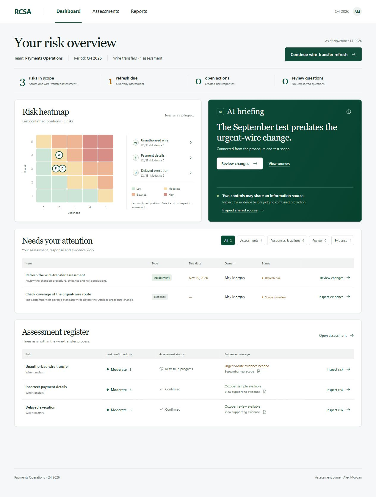

### 2. Changes — healthy after changes

The actual procedure change and near miss now appear before optional research. The AI connection still has a visible entry point. Scope confirmation remains a separate owner action.

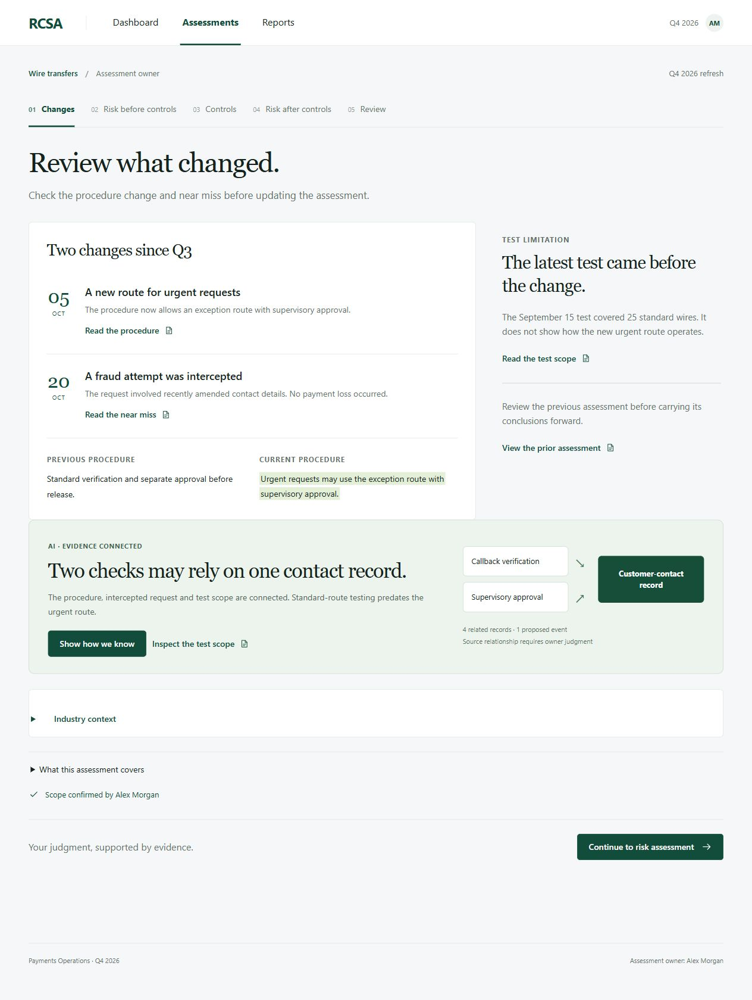

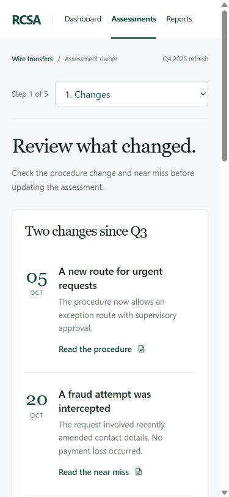

### 3. Risk before controls — clearer, with detailed supporting context

The heading explains inherent risk in everyday language. Ratings, rationale, history and the AI analysis remain available. Evidence titles open source excerpts directly. History charts remain dense on phones; specialist usability and assistive-technology testing would help assess that detail.

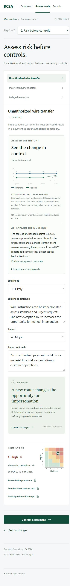

### 4. Controls and plans — healthy after changes

Recommendations still cover existing controls, enhancements and new designs. Current controls and the owner conclusion are easier to reach. The mobile selector exposes every assistance section. Plan tasks use ordinary form fields; adding/removing tasks retains useful focus.

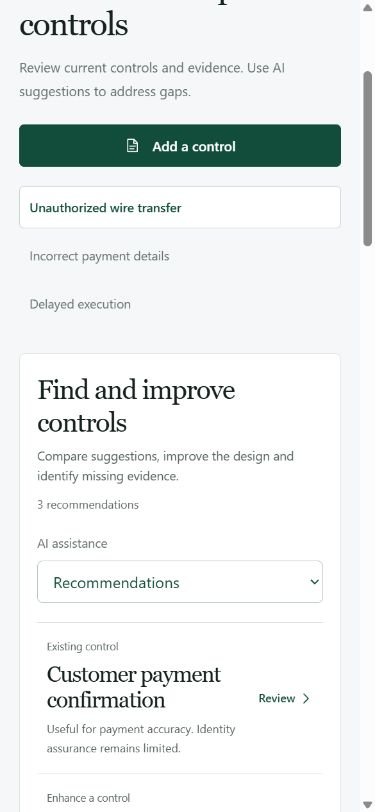

### 5. AI analysis and evidence — healthy after changes

One direct section menu replaces the group/detail layers. Mobile users get a complete section selector. Evidence inspection returns to its parent draft with edits intact.

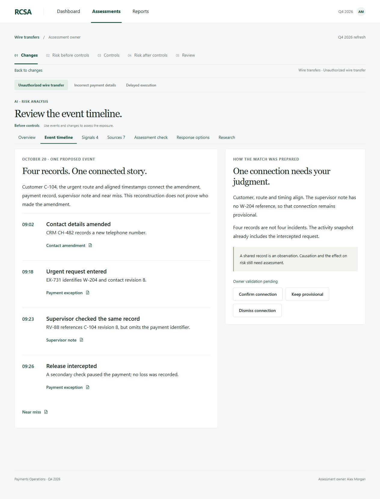

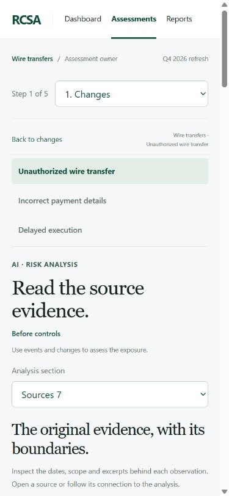

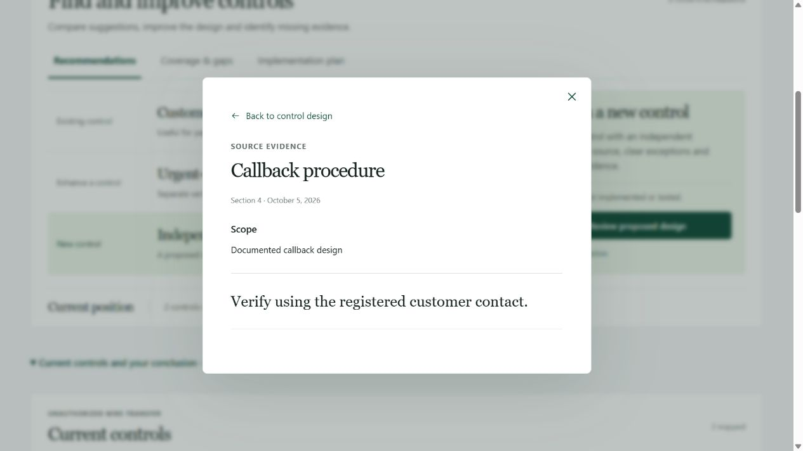

### 6. Risk after controls and response — clearer, with detailed supporting context

The heading explains residual risk. Draft ratings are explicit and response guidance explains what to complete before confirmation. Proposed work does not receive current operating credit.

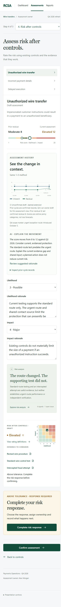

### 7. Owner and independent review — healthy after changes

Incomplete submission requirements now offer a direct Review action. Owner and reviewer roles stay distinct. A reviewer can inspect the AI question's sources and return to the draft without sending it.

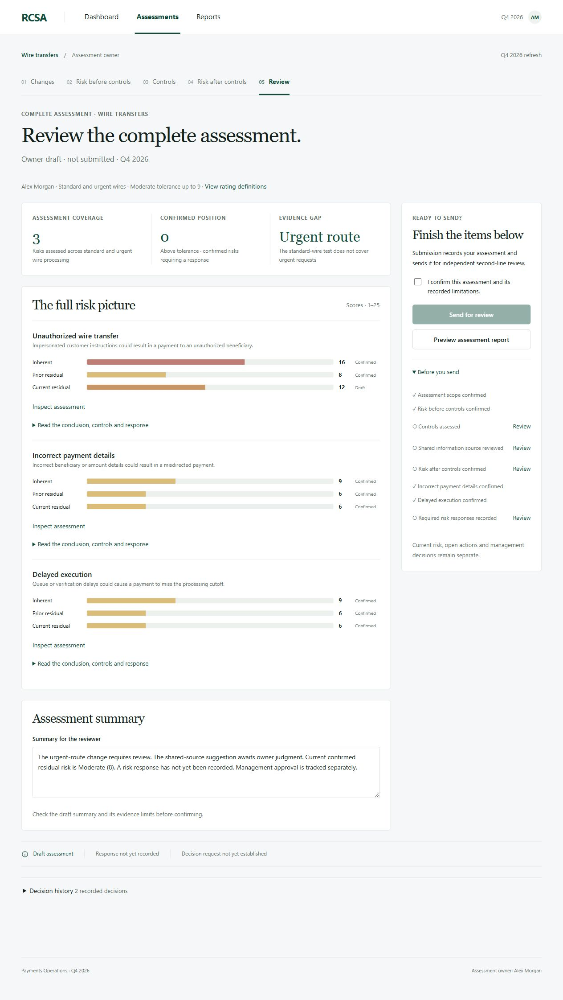

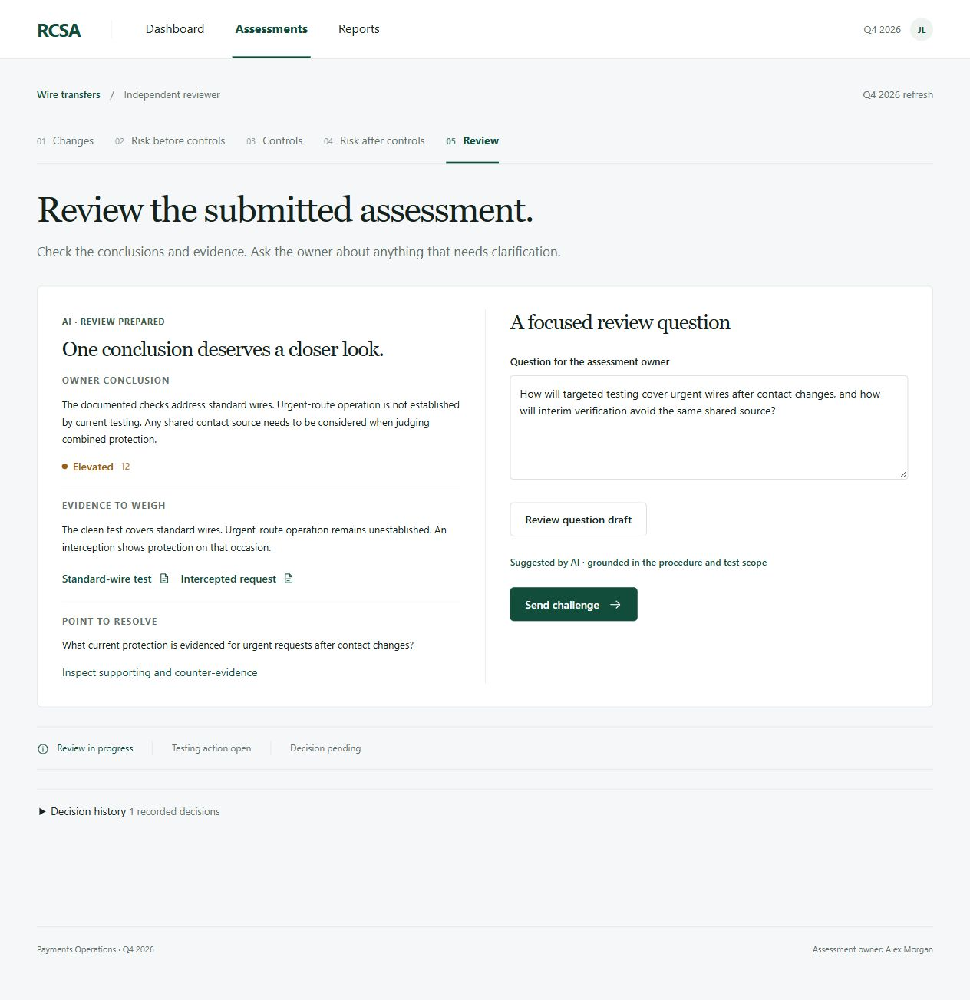

### 8. Reports — healthy after changes

The title names the document. The summary appears once; confirming it remains separate from confirming risk, closing work or granting approval. No empty management-decision column appears when no request is established.

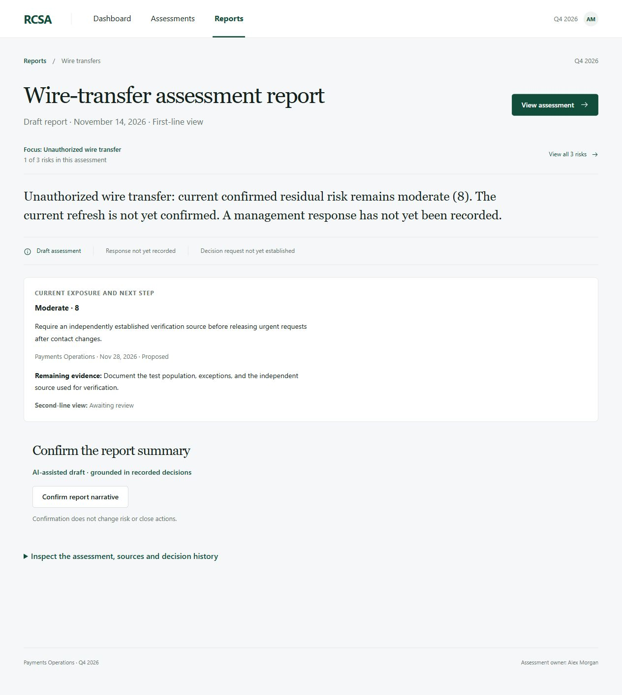

## Validation and limits

All eleven Node verification scripts passed: demo, product refinements, owner revision, mapping applicability, risk intelligence, risk matrix, persona fixes, report refinement, control assistance, control-assistance workflow, and the new UX navigation checks. All demo modules passed syntax checks. Relevant demo, report and navigation checks were rerun after the final report copy/layout change. The independent navigation review also exercised 2,563 state assertions without finding another material issue.

Browser checks covered desktop and 390 × 844 mobile layouts, state-aware resume, native selectors, direct excerpts, draft preservation, Back/Escape, focus return, task add/remove, selected-control plan generation, submission blocker links, owner review and reviewer question drafting. No horizontal page overflow was found on the checked mobile risk, controls and analysis screens. The test tab reported no console warnings or errors.

This is an expert review of a synthetic local demo, not measured customer research or full accessibility certification. Screen-reader use, zoom, contrast, other browsers and real users were not comprehensively tested. The history charts warrant particular attention on small screens. No live model, live research, external ingestion, production submission or deployment was tested or introduced.

Before screenshots are retained in `assets/screenshots/ux-copy-navigation`: 01 (Changes), 02 (Dashboard), 03 (analysis), 04 (controls), 05 (source dialog). Screen 10 captured an intermediate mobile assistant menu; its clipped menu was subsequently replaced by the selector shown in screen 11. Screen 09 is a desktop context reference, not mobile evidence.
