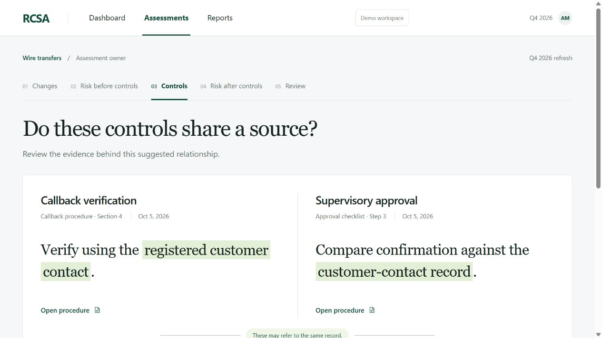
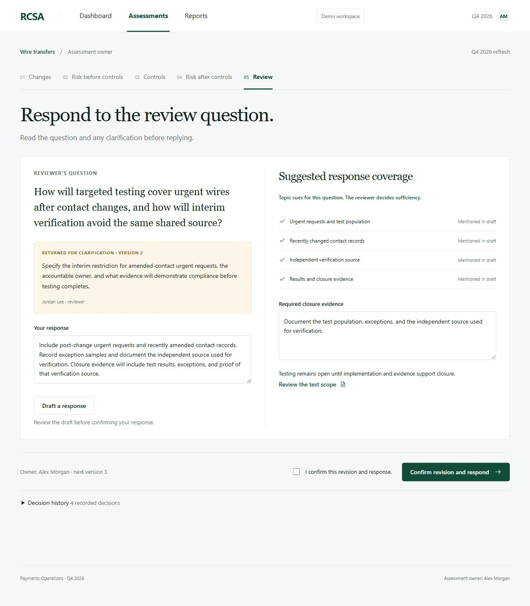

# Simulated large-bank buying committee

November 14, 2026. Three separate agents reviewed the current app as fictional potential buyers. These are expert roleplayed reactions, not customer interviews, validated market research, testimonials or a named bank's requirements. The agents shared the product brief and conversation context; this was not a blinded study.

## Committee verdict

**The app earns another meeting. It does not yet provide enough evidence for a purchase decision.**

All three reviewers found a valuable, visually credible evidence-to-decision workflow. They would continue evaluation and could consider a bounded pilot after agreeing methodology fit, integration responsibilities and success criteria. They did not infer production readiness, company implementation capability or proven ROI from the polished prototype.

The principal commercial uncertainty is whether this becomes an easier way to do existing bank work or a second assessment process that must be reconciled with the incumbent GRC. The next demonstration should answer that question explicitly.

The current implementation plan deliberately excludes live authentication, integrations, backend services, ingestion and models. That is a prototype scope boundary. It is not evidence that the company cannot deliver an enterprise solution. Likewise, the absence of delivery credentials from this repository does not establish that the company has none.

## Buyer positions and scores

Scores measure confidence supported by this demo and reviewed material. Anchors: 1 serious obstacle/unproven; 2 weak evidence; 3 promising with material gaps; 4 convincing within reviewed scope; 5 compelling/proven within reviewed scope. They are qualitative judgments, not measured customer ratings. No average is used.

| Fictional role | Ease | Insight/value | Polish/realism | GRC fit evidence | Implementation confidence evidence | Buying position |
| --- | --- | --- | --- | --- | --- | --- |
| SVP Payments Operations | 3/5 | 4/5 | 4/5 | 1/5 | 2/5 | Follow-up workshop; conditional pilot interest |
| Head of Operational Risk | 3/5 | 4/5 | 4/5 | 2/5 | 2/5 | Structured evaluation; pilot conditional on methodology, handoff and delivery evidence |
| Enterprise Architecture / Procurement lead | 3/5 | 4/5 | 4/5 | 2/5 | 2/5 | Technical discovery; bounded pilot design after agreeing architecture and responsibilities |

### Operations buyer

**Simulated reaction:** “If the answer still has to be rekeyed into our GRC, I have bought a second process. Show me how the approved conclusion gets back to the existing record.”

The first minute makes sense: team, period, work item and a specific evidence gap. The shared-source comparison earns attention. Repeated-use efficiency is less convincing: history displaces decision fields, control authoring is a long form, and one assessment with three risks does not establish portfolio workload or reuse.

The buyer wants to see the twentieth assessment, including an unchanged case, and understand which tasks disappear. They would prioritize a credible GRC roundtrip before more polish for a mixed buying committee. If integration were already established and the next audience were analysts testing adoption, they would prioritize task-first simplicity instead.

[Operations review: five objections and nine screenshots](operations/review.md)

### Risk sponsor

**Simulated reaction:** “I can see a more useful challenge conversation here. Show me how it lands back in our GRC with the right version, owner and evidence references.”

The sponsor values the separation of evidence, inference and human judgment, preservation of submitted versions, and the report's distinction between review completed, testing open and management decision pending. They need proof of fit with the bank's methodology and a broader assessment estate.

They agree that integration deserves priority but would not postpone task simplicity until integration is proven. Their condition for becoming an internal champion is a client-relevant assessment progressing from changed evidence through independent challenge and management decision to a reconciled GRC handoff, with responsibilities and measurable pilot outcomes agreed.

[Risk review: five objections and eight screenshots](risk/review.md)

### Technology / procurement buyer

**Simulated reaction:** “The screen design gets you a technical workshop. A delivery team, a scoped pilot and a believable data flow are what get us to an implementation decision.”

The architecture lead sees a plausible evidence workbench alongside GRC, but the app also contains a control library, assessments, actions and approval-related states. The boundary between incumbent and workbench is unclear. The reviewed evidence does not establish external record ownership, identity/data/model boundaries, methodology configuration, synchronization recovery or support accountability.

They would accept a clearly labelled synthetic roundtrip and reference adapter for the next meeting. They would not demand a production-certified connector before discovery or pilot design. They would require a feasible interface and an honest statement of what the pilot must prove.

[Technology review: proof before discovery versus during a pilot, with five screenshots](technology/review.md)

## What already makes the product credible

1. **A useful trigger for action.** The procedure changed after the latest control test. The user can inspect dates and scope rather than accepting a generic AI warning.
2. **A visible insight.** The two controls may rely on the same customer-contact record. Side-by-side excerpts make this understandable to an executive and testable by an assessor.
3. **Human-owned decisions.** The user can confirm, qualify or dismiss a relationship. A proposed measure does not silently lower current risk.
4. **Version-aware evidence.** New facts are compared with the submitted record and require an owner revision.
5. **Management relevance.** The report states a decision, responsible role, forum and target date while leaving testing and disposition open.
6. **A consistent visual identity.** The reviewers found the typography, restrained green palette and record context convincing. A wholesale redesign was not their priority.

## What prevents stronger buying confidence

### Priority 1 — Make the GRC relationship tangible

The reviewed screens do not demonstrate authoritative-system ownership, imported external IDs, approved writeback or reconciliation. Stable internal fixture IDs and local snapshots are useful design foundations; they do not establish a connector or durable enterprise audit trail.

For the next buyer meeting, propose one clearly labelled synthetic journey:

1. Start with an assessment and control in a reference GRC representation, with stable external IDs.
2. Show what enters this workspace, which system owns each field, and which values are read-only.
3. Run the strongest existing evidence/insight/owner-decision sequence.
4. Preview the exact human-approved update and evidence references that would return.
5. Show a rejected or stale update and an operator-visible reconciliation path.
6. Finish at the matching reference record, with the version and outcome inspectable.

This is proposed work, not an existing capability. Label a stub or simulated endpoint explicitly. A real selected sandbox adapter and integration reliability tests can follow in a scoped pilot. Do not substitute logos, fabricated synchronization activity or unverified success states for evidence.

### Priority 2 — Prove quick daily work

Make required judgment, unresolved items and next action visible before the full history. Show current control → proposed changes as a reviewable edit, with the existing library and field mapping preserved. Demonstrate one changed and one unchanged assessment without presenter coaching.

A useful adoption exercise would measure task correctness, effort, manual re-entry, reviewer returns and whether the insight changes a decision. No productivity percentage or ROI was established by this panel.

### Priority 3 — Correct assistance after returned clarification

The risk agent returned a response asking:

> Specify the interim restriction for amended-contact urgent requests, the accountable owner, and what evidence will demonstrate compliance before testing completes.

The exact feedback was retained, which is a strength. However, the original four topic-mention cues remained green even though the reply did not yet specify the requested restriction and accountable owner. The labels accurately describe mentions and do not claim sufficiency, but their visual completion pattern no longer tracks the latest clarification.

Revise coverage from the current question plus return feedback, or explicitly label the old checklist as covering the original question and keep the new request visibly unresolved. This is an observed remaining issue, not a fix made during this review.

The risk buyer did not treat it as a discovery blocker. They could accept a controlled pilot with explicit limitations and manual review, but would require correction before using those cues as production review guidance.

### Priority 4 — Show fit to a bank's method and workload

The five-point example and three-risk register are coherent. They do not prove support for a different taxonomy, hierarchy, tolerance, delegated authority or review process, nor a large portfolio's prioritization needs.

For evaluation, present one representative methodology mapping and a varied synthetic queue. Distinguish configuration, connector work, product development and unsupported requirements. Show carried-forward, changed and review-required records explicitly. Let the buyer explain why one assessment needs attention before another.

### Priority 5 — Make working with the company concrete

This does not require a sales page inside the assessment workflow. Bring a concise implementation and diligence package to the next conversation:

- Product boundary and proposed data/identity/AI flow, marked delivered, proposed or undecided.
- Scope, responsibilities and decision points for bank and vendor.
- Actual implementation and support roles, escalation path and change ownership.
- Pilot inputs, environments, acceptance tests, dependencies and stop/exit criteria.
- Configuration and migration approach for the selected methodology and GRC.
- Verifiable company credentials or references, where available; no invented certifications, staffing or delivery claims.

The app should show record origin, external IDs, current actor, field permissions and integration outcome when those are implemented. Architecture, data handling, service commitments and company evidence belong principally in the supporting materials.

## Buying gates from this simulated panel

| Stage | Proof that would move the conversation |
| --- | --- |
| Another meeting | Existing evidence insight, coherent workflow and polished UI already support this |
| Joint discovery / evaluation | Explicit workbench-versus-GRC boundary, representative record journey, relevant methodology discussion, bank and vendor participants |
| Bounded pilot | Agreed source data, interface/mapping, architecture and responsibilities; actual test environment; useful and measurable adoption/insight/integration outcomes |
| Purchase / production decision | Results from the pilot and the buyer's actual security, integration, service, implementation and commercial review—not inferred from this prototype |

These are roleplayed evaluation conditions. They are not universal banking procurement or regulatory requirements.

## Current review coverage and health

| Step | Experience inspected across the panel | Health |
| --- | --- | --- |
| 1 | Dashboard, entry and disclosure | Credible first impression; GRC relationship unproven |
| 2 | Changed procedure, near miss, test limitation and sources | Strong reason to reassess |
| 3 | Inherent risk and history | Functional; required fields displaced by context |
| 4 | Current controls, library and suggestions | Useful domain model; ownership/import story unproven |
| 5 | Proposed-control editor | Detailed but heavy authoring burden |
| 6 | Shared-source comparison | Strongest insight-to-judgment moment |
| 7 | Residual response and owner submission | Clear decision boundaries; repeated confirmation and carry-forward context need attention |
| 8 | Reviewer decision and returned clarification | Feedback retained; cues lag changed clarification |
| 9 | Leadership report and three-risk register | Strong management framing; portfolio use and operational handoff unproven |
| 10 | New evidence versus submitted version | Strong version awareness; substantial navigation/reading |

## Method and limits

Three role briefs were run separately, followed by a short roundtable on the next demonstration priority. The operations reviewer exercised the owner journey through local submission; the risk and technology reviewers used isolated prepared scenes for later states. All three formed initial product impressions before inspecting relevant documentation. The panel did not contact actual buyers or external systems.

The individual reports contain 22 current-run screenshots, each saved and reopened by its reviewer. The synthesis author additionally inspected the shared-source and new-evidence captures. Source fingerprints for 34 app/fixture files were checked after the panel: no changes. No product fixes, deployments, external messages or production actions occurred.

No actual user time study, production security/architecture assessment, enterprise-scale benchmark, integration proof, universal regulatory analysis or full accessibility audit was performed. Small metadata and chart labels remain readability risks requiring dedicated verification. Unknown integration and company-delivery evidence is not a conclusion that those capabilities are absent.
