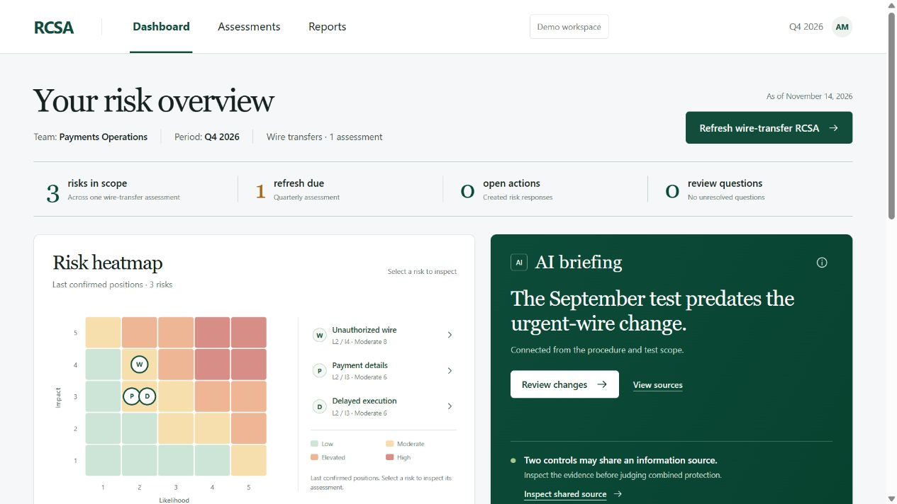
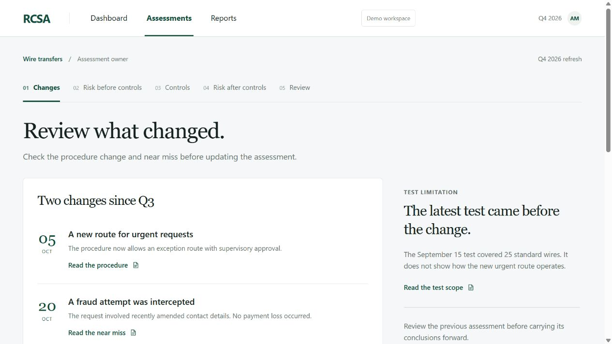
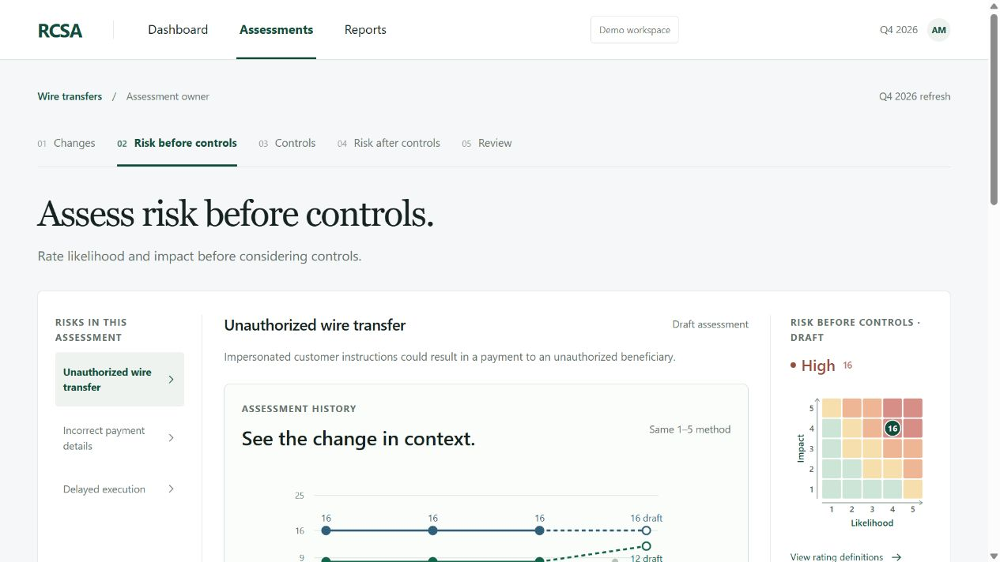
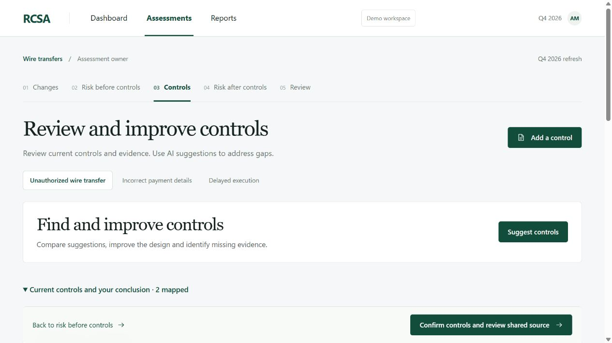
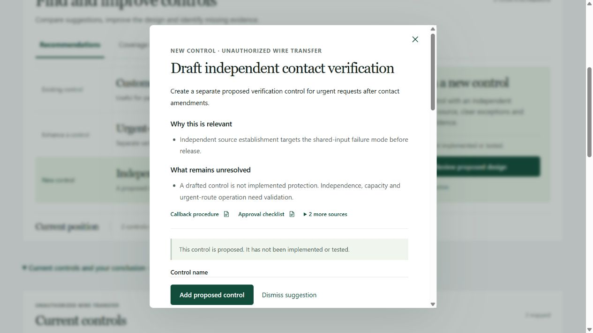
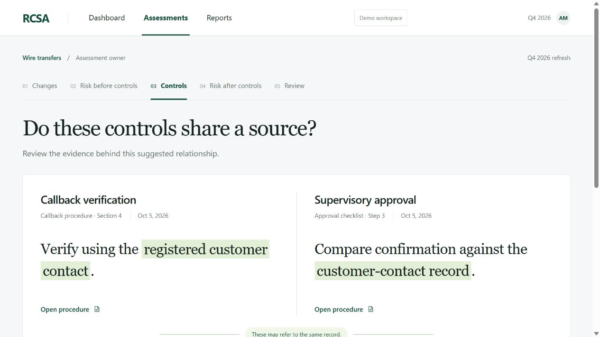
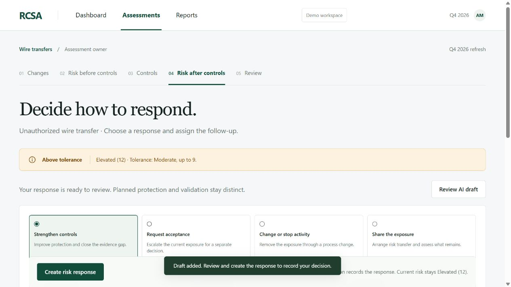
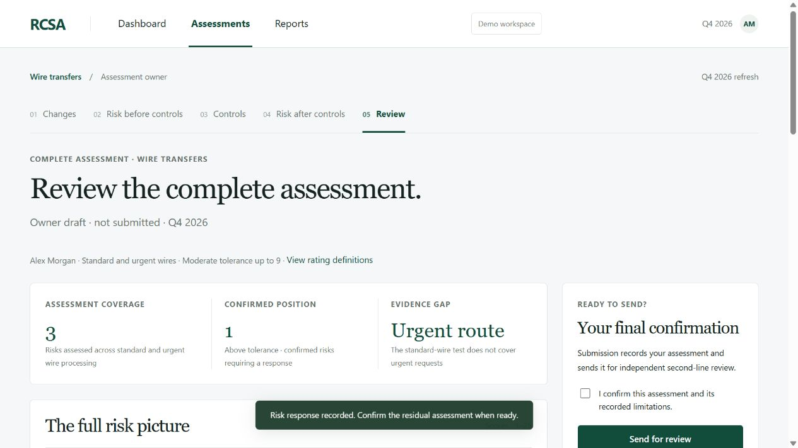
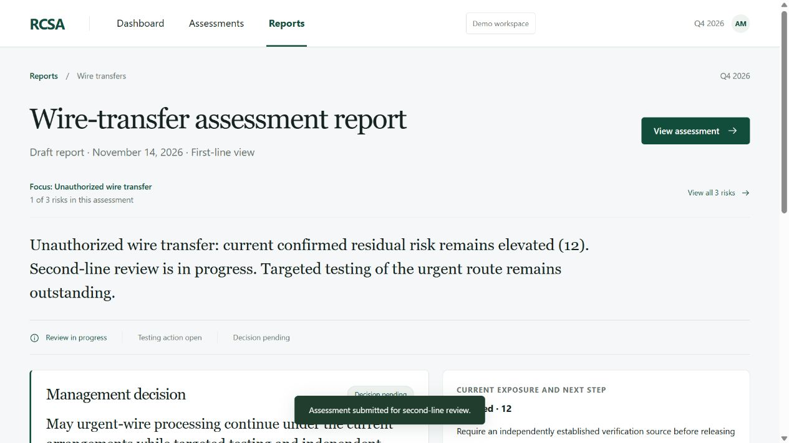

# First-line operations buyer — simulated review

November 14, 2026. Fictional persona: SVP Payments Operations and accountable owner of a large bank's wire-transfer RCSA process. This is expert roleplay, not customer research, testimony or a named bank's position.

I inspected the current running app in a new isolated tab, formed the product impression first, then read README and the workflow plan for capability boundaries. No prior buyer/audit verdicts were used. No product files were changed. Screenshots below were captured and reopened during this review.

## Buying stance

**Evaluate; conditional pilot interest.** I would accept a follow-up workshop with operations and our GRC owner. I would not yet sponsor production implementation or commit budget on this demonstration alone. The shared-source finding is valuable enough to continue the conversation. Evidence of integration, operating-scale usability and a deliverable implementation approach is insufficient for a buying decision.

The first minute is credible: a clear team, period, named task and evidence-related insight. The product looks considered. The uncertainty is whether this is a materially easier way to manage existing assessment work, or an attractive additional destination where my staff must repeat it.

## Comparable scores

Scale: 1 = serious obstacle/unproven; 2 = weak; 3 = promising with material gaps; 4 = convincing; 5 = compelling and proven within reviewed scope. These score confidence demonstrated by the demo, not the company's actual undisclosed capabilities.

| Dimension | Score | Reason |
| --- | --- | --- |
| Ease of use | 3/5 | Clear main progression and working confirmations; large contextual sections keep the actual decision below the initial working area. |
| Insight / value | 4/5 | The test-before-change limitation and shared information-source finding are specific, traceable and actionable. No measured staff-time saving or portfolio-wide detection quality was established. |
| Polish / realism | 4/5 | Consistent identity, real task language, named owners and versions; narrow long-form editing and the single-case universe still reveal demonstration limits. |
| Fit alongside existing GRC | 1/5 | Operational data exchange and authoritative-record ownership are unproven in the reviewed product. This is not a finding that the vendor cannot build them. |
| Vendor implementation confidence | 2/5 | The UI demonstrates thoughtful workflow design. The reviewed evidence does not yet show how the bank and company would jointly configure, test, support and roll out the implementation. |

## Three simulated first-person reactions

1. **Simulated:** “You have shown me something my team can miss: two separately described checks leaning on the same contact record. That earns another meeting.”
2. **Simulated:** “Before I call this easy, show me what my analyst actually does on their twentieth assessment, including the cases where nothing changed.”
3. **Simulated:** “If the answer still has to be rekeyed into our GRC, I have bought a second process. Show me how the approved conclusion gets back to the existing record.”

## Five objections and the evidence that would resolve them

### 1. I cannot tell how this avoids double entry

**Observed UI:** Dashboard, control mapping, owner submission and report all form a self-contained assessment workflow (01, 04, 08, 09). I did not see an external assessment/control identifier, authoritative-system label, sync state or a handoff back to an existing GRC during these tasks. That is an observation about the reviewed screens, not an exhaustive integration-capability audit.

**Document-only evidence:** README explicitly says there are no external services behind the illustrative interactions. `docs/operations/workflow-demo-plan.md:7` says portable output remains planned. This explains the demonstration boundary; it does not prove production integration is impossible.

**What I need next:** Walk one actual-shaped record from a bank's existing GRC into the assessment and show the reviewed change returning to the same external ID. Explain which system owns controls, ratings and actions; which fields can be edited; who approves write-back; what happens on conflict/failure; and how the source/version can be traced. If this is a proposed integration, label it as proposed and provide the concrete field mapping and pilot test instead of implying a connector exists.

### 2. The screen is polished, but the work is not yet exceptionally quick

**Observed:** On inherent assessment, history occupies the center while likelihood, impact and rationale are below the opening view (03). Controls opens with large headings and an assistance section, while the current-control conclusion is lower; the sticky confirmation is available before the conclusion is in the visible working area (04). Response is a separate page and returns me to residual risk for another confirmation (07–08).

**Buyer consequence:** For a knowledgeable owner repeating this process, the UI asks me to scan a presentation before reaching the decision. The sequence can be navigated, but the demo does not yet substantiate “incredibly easy.” I did not time a representative user, so this is an expert observation rather than a measured delay.

**What I need next:** A compact task-first view: what changed, current decision fields, unresolved requirements and next action together. Make the full history/evidence optional depth. Demonstrate an experienced analyst reviewing one unchanged assessment and one materially changed assessment without narrated coaching.

### 3. Improving a control looks like a substantial new authoring exercise

**Observed:** Review proposed design opens a long narrow dialog with objective, owner, design, frequency, population, information source, exceptions, retained evidence, validation, rationale and coverage judgment. Most content is outside the initial visible area, although the add action is fixed at the bottom (05). Existing/enhance/new recommendations are useful choices and are clearly labelled proposed.

**Buyer consequence:** A potentially helpful recommendation becomes another set of fields to reconcile with my bank's current control standard and library. The demo shows rich content, but not how that work is reduced or aligned with our required fields.

**What I need next:** Show “current control → proposed changes” as a reviewable patch with our existing field names and required metadata already mapped. Let the accountable owner accept/edit the specific change, then route it through the existing approval process. Keep full creation as a separate path when a genuinely new control is needed.

### 4. The evidence story is convincing; ongoing workload and reuse are unproven

**Observed:** The first dashboard is one assessment and three risks (01). The inspected journey concentrates on Unauthorized wire transfer. The final overview reports all three risks confirmed; the two supporting risks already carry their prepared positions (08). That can represent a coherent sample, but it does not show how I distinguish carried-forward conclusions from work I personally completed, or manage a large portfolio of cases.

**Buyer consequence:** I can see why this one finding matters. I cannot yet estimate rollout effort, operating capacity or which tasks disappear from the current process. Repeated “confirm” actions may be necessary accountability, but I need to understand the evidence of review behind each state.

**What I need next:** A representative queue with changed/unchanged cases, owners, overdue items and source freshness, plus per-risk “carried forward / changed / requires review” visibility. Establish a pilot baseline for elapsed handling time, owner edits, reviewer returns and useful findings. Do not claim a percentage saving without that comparison.

### 5. I do not yet have a concrete picture of buying and implementation with the company

**Observed UI:** The product makes operational roles and management decisions understandable (08–09), but the reviewed experience does not show implementation onboarding, bank-specific rating/tolerance configuration, identity-role mapping, data readiness or how our current workflow would be preserved. These may belong in the sales/implementation package rather than the daily app; their absence here is a demonstration evidence gap.

**Document-only evidence:** The local run instructions and explicit synthetic/service boundaries establish how to run the prototype, not a customer deployment plan (README, workflow plan).

**What I need next:** A short joint pilot plan naming the bank and vendor responsibilities, scope, source records, access pattern, configuration decisions, acceptance tests, service/support owner, exit criteria and path back to the bank's existing process. Explain what is available today and what would be built. That would give me a reason to trust this particular company with implementation, beyond liking the interface.

## Strengths I would repeat to the buying group

- The briefing identifies a meaningful assessment gap, not just a new document: September testing predates the new October route (01–02).
- The side-by-side comparison makes shared-source dependence understandable and gives me confirm/qualify/dismiss choices (06).
- AI can turn the gap into an editable response/action draft and requires a separate creation action. Planned measures do not lower current risk (07 and observed creation flow).
- The owner submission preserves a version and makes independent review a separate state. The leadership report separates current exposure, testing and a specific management decision (08–09).
- The consistent green/serif identity, stable navigation and restrained surfaces are presentable to senior operations leaders (01–09).

## Steps inspected and general health

| Step / capture | What I did | Health |
| --- | --- | --- |
| 1 / 01 | Opened dashboard and located the refresh | Good first impression; operational priority clear |
| 2 / 02 | Read changed procedure/near miss and opened test scope | Strong traceable reason to act |
| 3 / 03 | Confirmed scope; inspected inherent assessment and confirmed | Functional; decision fields displaced by history |
| 4 / 04 | Opened Controls and generated suggestions | Useful; current decision competes with optional improvement |
| 5 / 05 | Inspected proposed independent-contact control editor, then closed | Rich but heavy editing experience |
| 6 / 06 | Compared shared-source excerpts and confirmed the relationship | Strongest insight-to-owner-judgment moment |
| 7 / 07 | Opened residual response, previewed/used AI draft and created response | Functional; action/protection/evidence distinction clear in text and structure |
| 8 / 08 | Confirmed residual assessment, reviewed summary, attested and submitted | Clear handoff and version; supporting-risk carry-forward context needs clarity |
| 9 / 09 | Opened leadership report after submission | Useful management question; integration/portable handoff unproven |

## Screenshots

### 01 — Dashboard

### 02 — Changed evidence

### 03 — Inherent assessment

### 04 — Controls

### 05 — Proposed-control editor

### 06 — Shared-source evidence

### 07 — Response

### 08 — Owner review

### 09 — Leadership report

## Accessibility and review limits

The screenshots show small grey metadata and compact chart labels that warrant contrast/zoom checks. The proposed-control editor has extensive scrolling. No failure of contrast, keyboard access or screen-reader support was established; these were not exhaustively tested. No viewport override was used. The current available browser identified itself as an in-app surface at browser ID 2.

This bounded owner review did not complete the second-line challenge loop, test all supporting-risk edit paths, measure task times with real staff, validate integrations or evaluate deployed identity/data security. UI findings, document findings and hypothetical buyer requirements are labelled separately. The confidence scores do not imply that undisclosed capabilities are absent.
