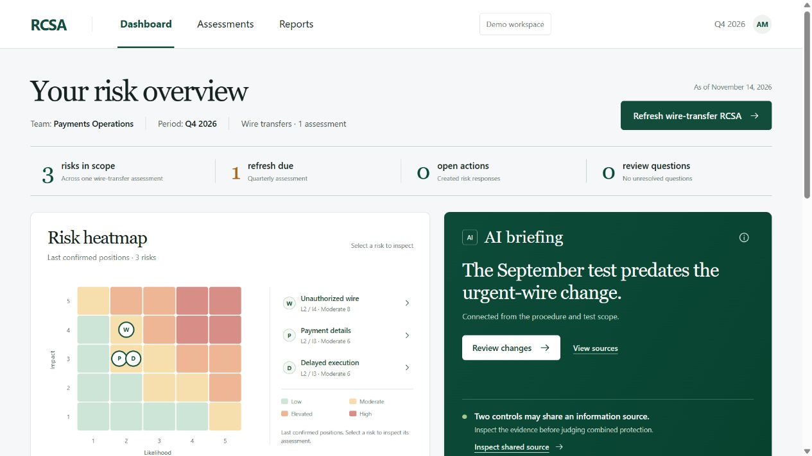
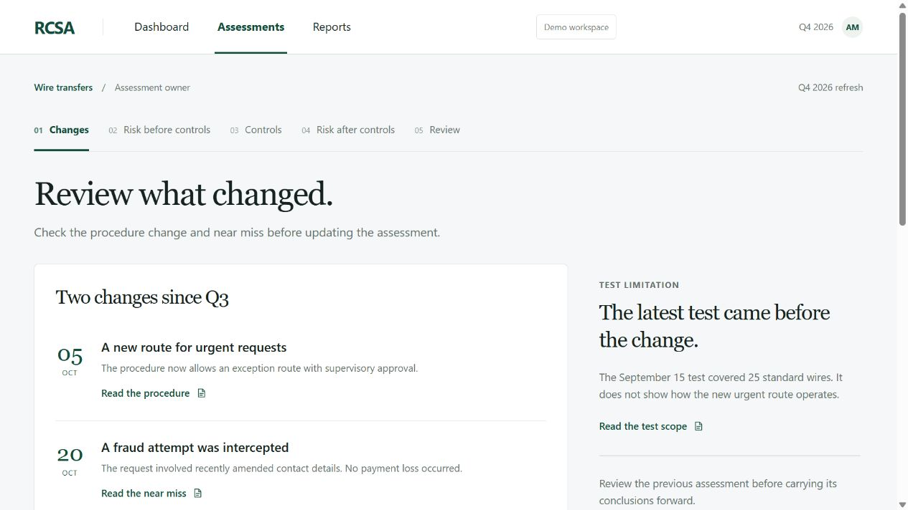
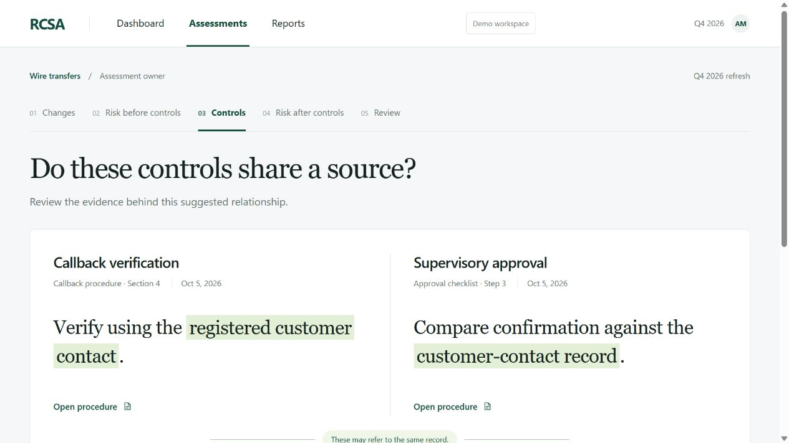
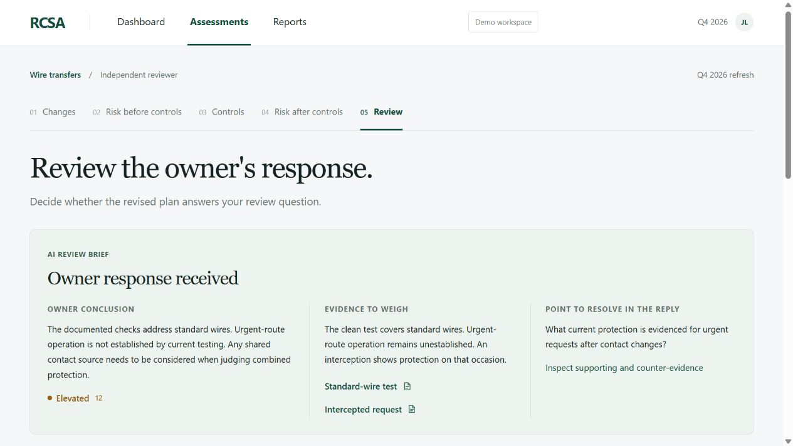
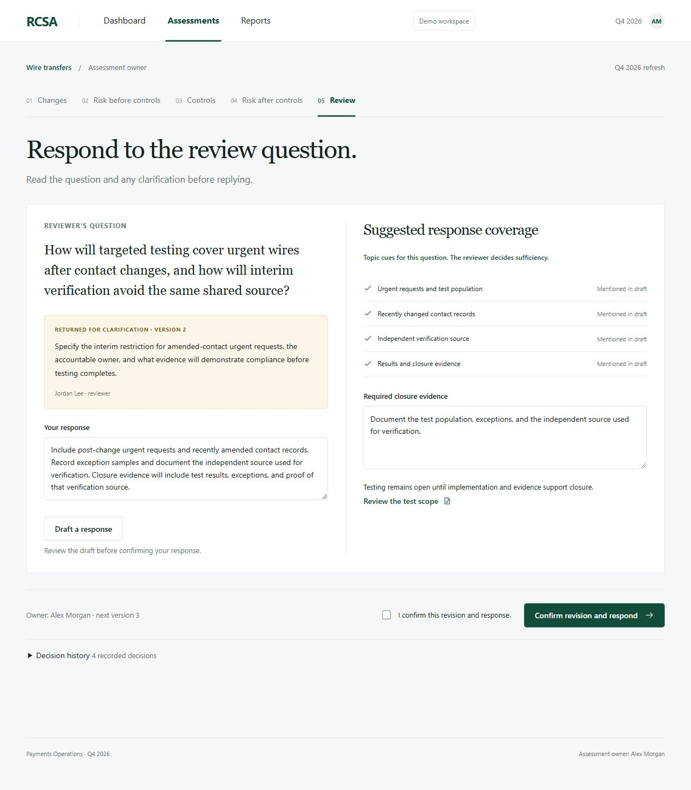
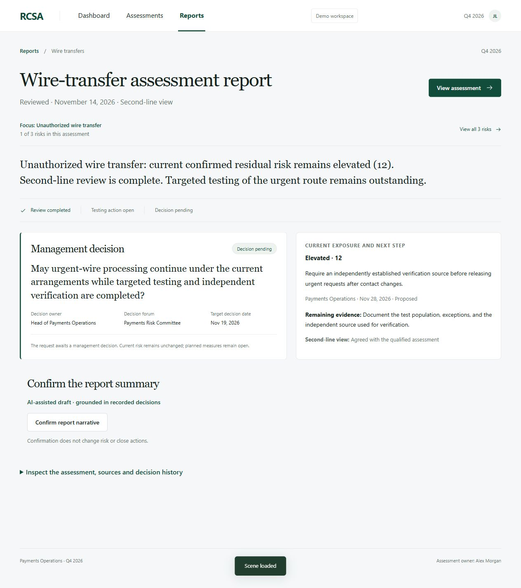
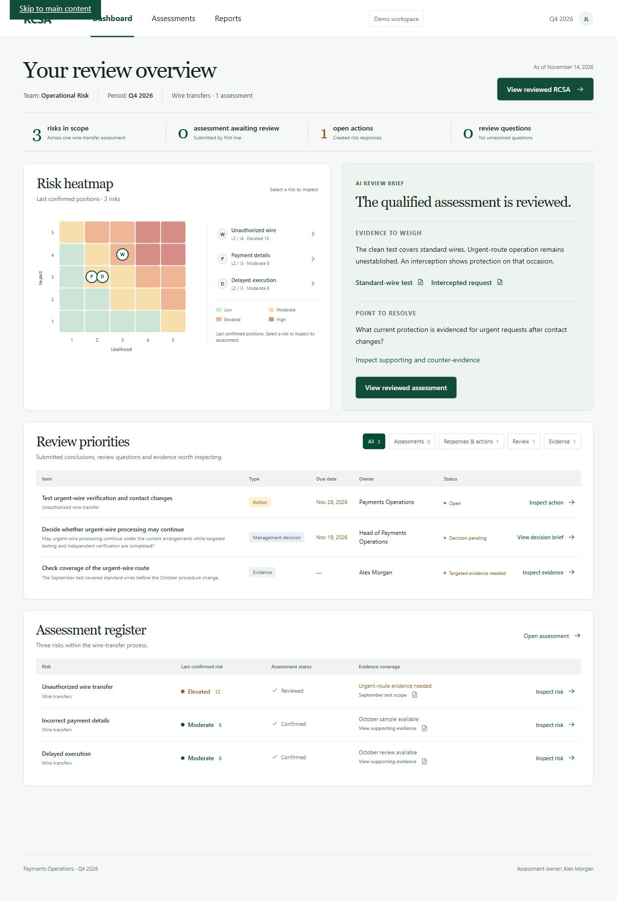
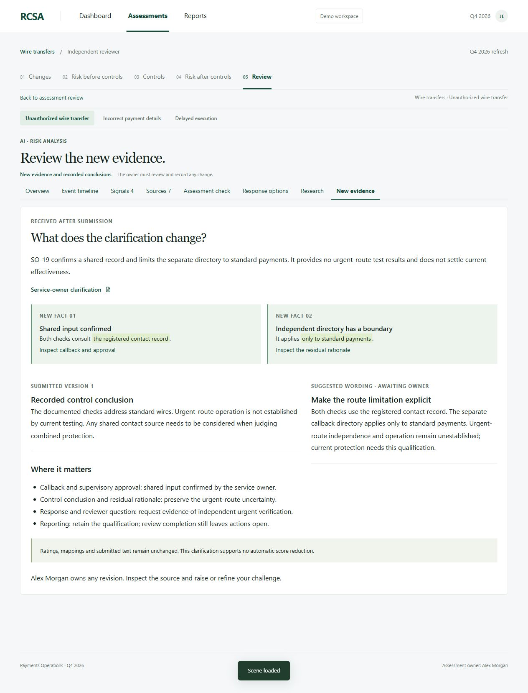

# Simulated large-bank buyer: Head of Operational Risk

November 14, 2026. Fictional second-line economic sponsor responsible for enterprise RCSA methodology. These are simulated expert reactions, not customer interviews, quotations from real buyers, or claims about a named bank. Current app inspected in an isolated browser tab; no product code changed. Prepared scenes were used to inspect later workflow states. Findings were formed from the product before reading its scope documents.

## Buying stance

**Proceed to a structured evaluation. A pilot is conditional; a production purchase is not yet evidenced.**

The app makes a compelling case that a better assessment experience is possible. It feels considered and visually credible. The dependence insight, preserved reviewer clarification and separate management decision are reasons to continue the conversation. It does not yet demonstrate how this experience fits my existing risk methodology, system of record, evidence estate and delivery model. That is an evidence gap in this review, not a finding that the company cannot provide those capabilities.

I would ask for a methodology-and-integration working session with my operations owner, risk methodology lead and GRC owner. A useful next demonstration would take one assessment from our existing taxonomy through evidence review, independent challenge and a versioned handoff back to the system of record. Any connector shown as illustrative must remain clearly labelled.

## Anchored scores

Scale: 1 serious obstacle/unproven; 2 weak evidence; 3 promising with material gaps; 4 convincing; 5 compelling/proven within reviewed scope. Integration and vendor scores assess the evidence presented, not actual company capability.

| Dimension | Score | Reason |
| --- | --- | --- |
| Ease of use | 3/5 | Plain-language task names and clear next actions, but long review screens and several navigation layers make it feel more involved than the five steps suggest. |
| Insight / value | 4/5 | Shared-source dependence and changed test scope connect evidence to an operational decision. Version-aware new evidence is useful. Value across a large assessment estate is not yet demonstrated. |
| Polish / realism | 4/5 | Consistent typography, restrained colour, meaningful record context and status language. Some small supporting copy and substantial vertical reading remain. |
| Fit alongside an existing GRC | 2/5 | Current product shows assessments and evidence, but no demonstrated source-of-truth boundary, ID mapping, reconciliation or approved-result handoff. |
| Vendor implementation confidence | 2/5 | The workflow shows domain understanding. Delivery architecture, responsibilities, operational support and an implementation proof point were not part of the reviewed evidence. |

## Three simulated first-person reactions

> **Simulated:** “The shared contact record is the first moment where I can explain to my committee why two controls may not provide two independent layers of protection.”

> **Simulated:** “I can see a more useful challenge conversation here. Show me how it lands back in our GRC with the right version, owner and evidence references.”

> **Simulated:** “I would bring my methodology and technology leads to the next meeting. I would not infer implementation readiness from the polished interface alone.”

## What works well

1. **The opening states a concrete reason for reassessment.** The changed route, dated near miss and test predating the change make the issue understandable without an AI explanation. Evidence 01–02.
2. **The dependency insight is inspectable.** Two excerpts are side by side, the matching phrases are highlighted, and the user can qualify or dismiss the relationship. Recording a relationship is distinguished from changing risk ratings. Evidence 03 and observed controls.
3. **The return path retains the actual reviewer feedback.** I returned the owner response with a custom clarification. The owner's view showed that exact text, the original question, existing reply and version together. Evidence 05.
4. **The leadership report asks for a decision.** Decision owner, forum and date are explicit. Review completed, testing action open and decision pending remain separate. This is materially more useful than a status-only summary. Evidence 06.
5. **New evidence does not silently rewrite a submitted conclusion.** The received clarification is compared against submitted version 1, with suggested wording awaiting the owner. The independent reviewer cannot directly make the owner revision from that view. Evidence 08.

## Five objections to resolve

### 1. “How does this operate alongside the GRC we already own?” — buying gate

**Observed:** The dashboard and report expose local assessment, action, evidence and decision concepts. They do not show originating enterprise record IDs, sync status or an outbound handoff. Evidence 01, 06–07.

**Document-only confirmation after the product review:** `docs/operations/workflow-demo-plan.md:183` explicitly excludes integrations, document ingestion, backend, authentication and production approval workflow from this demo. `docs/data-contracts/workflow-demo.md:11` describes optional sessionStorage. This is an intentional prototype boundary, not evidence of a promised production architecture.

**My condition:** Describe which system owns risk/control definitions, assessment status, evidence, actions and approvals. Show a representative mapping and reconciliation example, including a changed source record and a failed transfer. Demonstrate a handoff using synthetic data before describing integration as proven.

### 2. “Can this support our methodology without creating a second assessment standard?” — buying gate

**Observed:** The demo consistently uses one five-point model and an above-tolerance response. That clarity is a strength; it does not establish that an existing bank's dimensions, taxonomy, delegation and review rules can be carried across.

**Document-only evidence:** `docs/operations/workflow-demo-plan.md:44` identifies the sample bank's bands and tolerance. No methodology-configuration process was evaluated.

**My condition:** Take a representative client methodology and show the fit: identifiers, scoring dimensions, control assurance categories, appetite/tolerance, approval authority and permitted local variations. Clearly distinguish configurable behaviour, implementation work and unsupported differences. This is a request from this fictional buyer, not a universal bank standard.

### 3. “Will the insight still be valuable across our assessment estate?” — scope gap

**Observed:** The leadership report explicitly focuses on Unauthorized wire transfer, one of three risks. View all 3 risks opens the assessment register. It does not provide a cross-process or cross-entity risk view in the reviewed path. Evidence 06–07.

**Concern:** The demo proves a strong singular story. It has not yet shown whether second line can identify which of hundreds of assessments deserves attention, see common dependencies or compare evidence gaps across owners. No scalability or portfolio performance test was conducted.

**My condition:** Demonstrate a small but varied synthetic portfolio with several processes, owners and evidence conditions. Let me identify a review priority and explain why it outranks the others. Preserve source drill-through rather than presenting invented aggregate insight.

### 4. “Can my reviewers do this quickly and confidently without a presenter?” — adoption risk

**Observed:** At the default laptop viewport, the review page's large heading and evidence brief occupy most of the opening screen. The actual reviewer decision is lower. New-evidence analysis has primary navigation, assessment stages, risk selection and analysis sections before the comparison. Evidence 04 and 08.

**Concern:** Reading depth is useful, but the page does not immediately communicate the minimal decision path versus optional investigation. A busy reviewer has to find that distinction. The five-step navigation does not convey all of the investigation and revision work behind a step.

**Recommendation:** Surface “Your decision / unresolved point / evidence to inspect / next action” first, then expandable supporting context. Test a fresh reviewer on the task of returning an insufficient response and later finding the specific change. Do not claim time savings until observed against a reasonable baseline.

### 5. “Do the assistance cues follow the latest clarification?” — trust and repeated-use risk

**Test:** In the Response received scene, I selected Return for clarification and recorded:

> “Specify the interim restriction for amended-contact urgent requests, the accountable owner, and what evidence will demonstrate compliance before testing completes.”

The owner view correctly retained that exact clarification. It also kept all four green cues as **Mentioned in draft**, based on the existing reply about test population, contact records, independent sources and results. The reply did not yet specify the requested interim restriction and accountable owner. Evidence 05.

**Interpretation:** The labels are accurate as topic-mention cues; the screen explicitly says the reviewer decides sufficiency. I am not claiming it falsely certifies a complete reply. However, the visual completion pattern is no longer aligned with the latest clarification, which can encourage the wrong next action.

**Recommendation:** Rebuild suggested coverage from the latest question plus return feedback, or label the existing cues as the original-question checklist and keep the new clarification visibly unresolved until reviewed. A good repeated-use demonstration should include a reviewer changing the required information, not just accepting the original prepared response.

## Evidence needed to move toward a pilot

- A client-specific methodology mapping and system-of-record ownership map.
- A synthetic import/review/versioned-handoff demonstration, including reconciliation and an error case. Integrations need not be represented as already delivered.
- A proposed pilot operating model: participant roles, supplier/client responsibilities, evidence access, success criteria and stop conditions.
- Evidence appropriate to the actual hosting and AI architecture: access control, audit retention, data handling and support responsibilities. None was verified by this UI review, and their absence from the demo does not establish their absence from the company's offering.
- Task-based observation of two users who did not rehearse the script: assessment owner and second-line reviewer. Use correctness, effort and usefulness measures rather than invented ROI.

## Numbered walkthrough and general health

| Step | Surface / action | General health |
| --- | --- | --- |
| 1 | Dashboard first impression | Credible; immediate evidence-oriented briefing, narrow demonstrated scope. |
| 2 | Changed procedure, event and test limitation | Strong; concrete trigger for reassessment. |
| 3 | Shared-source dependency | Strong; inference, source support and human decision are distinguishable. |
| 4 | Received-response review | Functional; decision requires scrolling below substantial context. Prepared scene contained prefilled judgments, so those are not treated as evidence of normal default values. |
| 5 | Return custom clarification to owner | Strong retention; topic cues do not reflect the new clarification. |
| 6 | Completed-review leadership report | Strong decision framing; one main risk remains the focus. |
| 7 | View all three risks / assessment register | Clear local register; cross-portfolio prioritisation is unproven. |
| 8 | New evidence against submitted version | Strong version awareness; navigation and reading load are substantial. |

## Screenshots captured in this review

### 01 — Opening dashboard

### 02 — Reason for reassessment

### 03 — Shared-source comparison

### 04 — Reviewer opening view

### 05 — Exact clarification retained, original topic cues still green

### 06 — Leadership report

### 07 — Three-risk register

### 08 — New evidence compared with submitted text

## Limits and accessibility observations

The captures are from the current running app and were saved and reopened before acceptance. No prior screenshots or audit conclusions supplied the evidence for this review. Browser ID 2 exposed an in-app browser in this agent's runtime despite the parent context's older Chrome description; an isolated tab was used. No browser resize, user-tab mutation, live system operation or external communication occurred.

The prepared scenes accelerated later-state inspection. They do not prove the full owner-to-report journey was completed in this run. The custom return action and its exact feedback persistence were exercised directly. Backend authorization, immutable storage, integrations, enterprise-scale performance and company delivery capability were not verified.

Visible contrast and spacing appeared generally coherent. Small metadata, source text and chart labels deserve measured contrast/zoom checks. No screen-reader, complete keyboard, responsive or WCAG-conformance audit was performed. One locator mismatch was resolved by inspecting the current DOM and selecting the correctly named combobox; that tool issue is not reported as a product accessibility failure.
