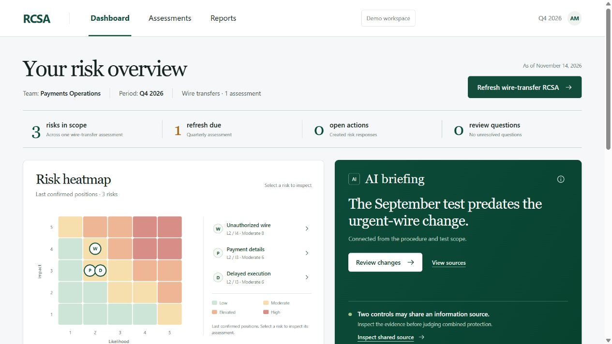
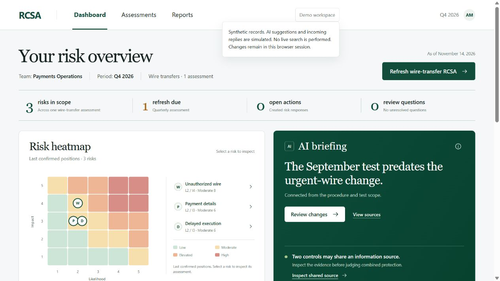
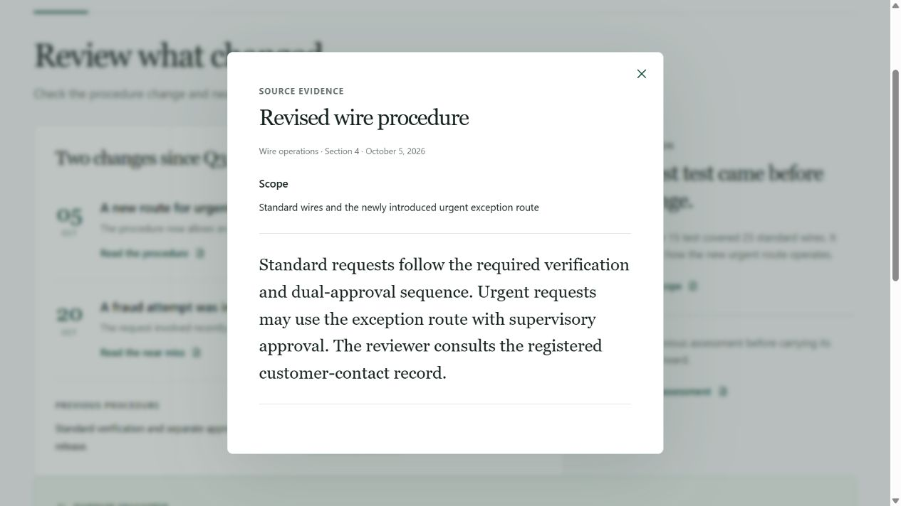
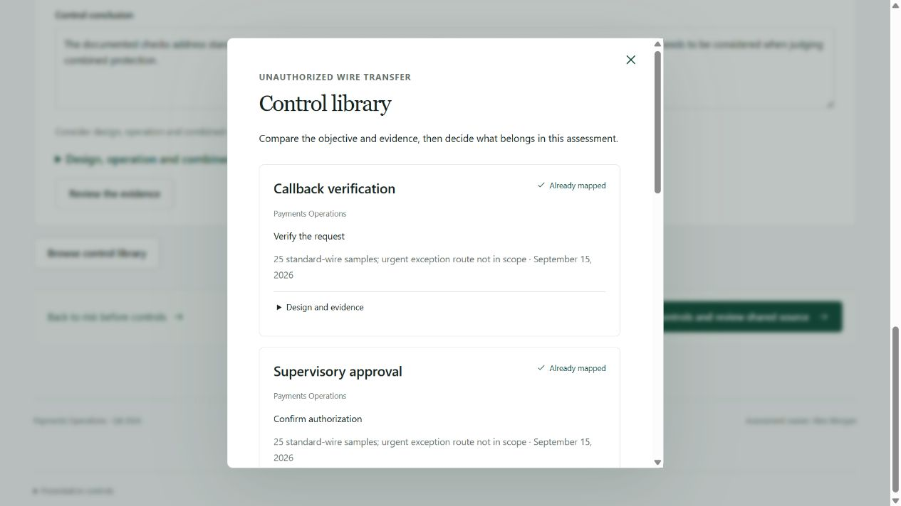
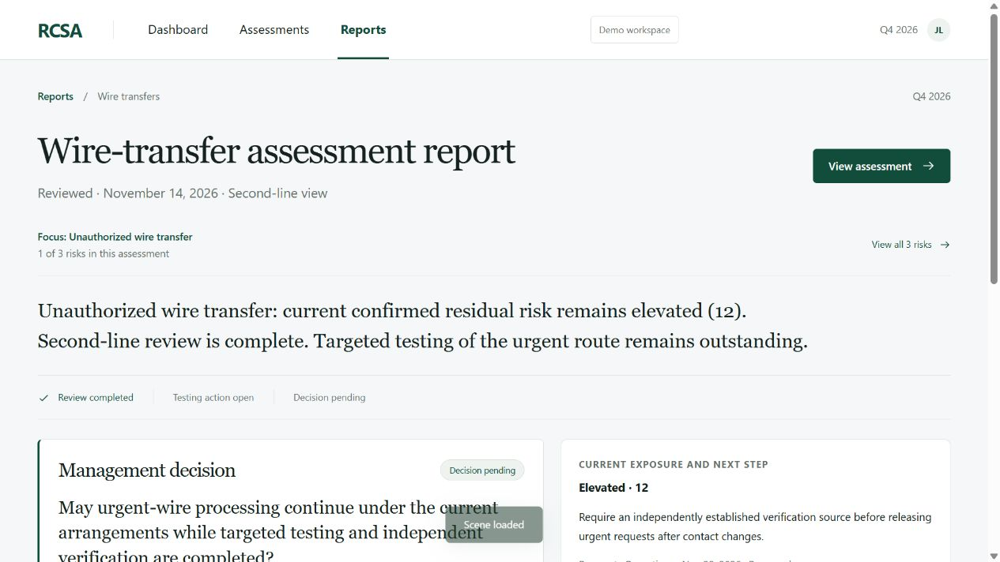

# Fictional large-bank technology / procurement buyer

Reviewed November 14, 2026. This is simulated expert feedback from an enterprise architect working with procurement and third-party risk. It is not testimony from an actual bank, a prediction of a named bank's requirements, or a production-readiness certification.

## Buying stance

**Evaluate: invite the company to a technical discovery workshop.** The product is polished enough and the evidence-to-decision story is coherent enough to merit the conversation. I would not infer integration readiness or approve a production purchase from this demonstration. A bounded synthetic-data pilot could follow once the system-of-record boundary, proposed architecture, responsibilities and success criteria are agreed. A working production connector is not a prerequisite for discovery.

The value proposition is easiest to understand as an assessment and evidence workbench alongside an existing GRC. The current screens also resemble a self-contained GRC workflow: control library, mappings, actions, submissions, review and management decisions. Without an explicit boundary, I cannot tell which records the bank continues to govern in its incumbent platform and which records this product would own.

## First impression, before reading technical documents

The dashboard feels considered and professional: consistent typography, clear spacing, restrained colour, an evidence-led briefing and an obvious action. It demonstrates banking work rather than generic AI chat. The dated source detail and control library make the insight tangible. The management report separates review completion, testing and management decisions rather than suggesting that everything is resolved.

The navigation provides Dashboard, Assessments and Reports. In those reviewed surfaces I did not see an explanation of source-system origin, imported record identity, integration health or writeback ownership. That is an unproven integration story, not evidence that the company cannot integrate. I would ask the presenter to show where this fits before discussing a purchase.

## Scores

Anchors: 1 = serious obstacle or unproven; 2 = weak evidence; 3 = promising with material gaps; 4 = convincing in reviewed scope; 5 = compelling and proven in reviewed scope. These are confidence scores for this inspection, not objective product metrics.

| Dimension | Score / 5 | Reason |
| --- | --- | --- |
| Ease of use | 3 | Clear entry and straightforward source inspection; recurring bank-scale work and integration exceptions were not exercised. |
| Insight / value | 4 | The test-date mismatch, source independence and management follow-up are concrete and decision-relevant. Live discovery quality is unproven. |
| Polish / realism | 4 | Cohesive visual language and credible record detail. The explicit demo disclosure is appropriate; it does not undermine the visual quality. |
| Fit alongside existing GRC | 2 | Logical entities and stable internal IDs are documented, but the incumbent-to-workbench boundary and synchronization are not demonstrated. |
| Vendor implementation confidence | 2 | The repo shows disciplined local workflow contracts and verification. A bank implementation plan, operating architecture and service accountability were not established. |

## Five objections and the proof each needs

### 1. Where does the incumbent GRC remain authoritative?

**Evidence:** Screens 01, 03–05 show an assessment, source evidence, a control library, mappings, an action and a management request. They do not show whether these are imported, locally created or synchronized. `docs/data-contracts/workflow-demo.md:5` documents stable source/control IDs for the fixtures, which is useful design discipline but is not an external-ID mapping contract.

**Buyer concern:** I do not want parallel libraries, conflicting action statuses or another place to maintain the same risk.

**Before the next workshop:** explain the product boundary on one slide and show a clearly labelled synthetic record journey. Identify which system owns each field and who approves writeback. A simulated adapter is acceptable when explicitly identified.

**During the pilot:** prove a selected connector and the agreed field mappings against an authorized sandbox, with incumbent IDs preserved and read-only versus writable fields enforced. A proposed connector is not a verified capability.

**Where it belongs:** record origin, external ID, current synchronization status and writeback preview in the app; field ownership and supported integration patterns in the architecture/data-mapping pack.

### 2. How will identity, bank data and AI processing be bounded?

**Evidence:** Screen 02 clearly discloses synthetic records, simulated AI and browser-session state. `docs/operations/workflow-demo-plan.md:183` explicitly excludes real authentication, model calls, integrations, ingestion and backend services from the demo. `src/scripts/demo/app.js:23` stores local demo state; role perspective is changed through presenter controls. These are intentional prototype boundaries, not findings about the company's proposed production security.

**Buyer concern:** I cannot infer how a real employee's identity maps to role and approval authority, or where evidence and model prompts would be processed.

**Before the next workshop:** provide a proposed data-flow/identity diagram with a clear list of implemented, configurable, proposed and undecided elements. Identify deployment options, evidence stores, model/provider boundaries and whether customer content leaves the bank's chosen environment. Avoid unsupported certification or residency claims.

**During the pilot:** verify the agreed identity and least-privilege mapping, evidence access rules, logging and model/data-handling behavior in its actual environment. The parties should agree what is required for that pilot; this report does not assert one universal bank policy.

**Where it belongs:** current actor, record owner and permission consequences in the app; security, privacy, hosting and AI operating details in diligence material. A demo need not contain a security-settings page to establish these answers.

### 3. Can this use our methodology and existing taxonomy without a custom rebuild?

**Evidence:** The current fixture contract documents a fictional five-point method and tolerance. `src/scripts/demo/model.js:5` defines the likelihood and impact labels; `src/scripts/demo/app.js:65` renders the fixed demonstration scale/tolerance. The reviewed UI contains a single process and three risks. I did not exercise a configuration UI or migration path.

**Buyer concern:** A polished example is less valuable if deploying it requires replacing our established scoring definitions, risk/control IDs, organizational hierarchy or review process.

**Before the next workshop:** show a mapping/configuration specimen using a second synthetic taxonomy and identify what would be configuration, connector work or product development. Do not claim that the current fixed demonstration establishes generic configurability.

**During the pilot:** load a bounded representative assessment set and test agreed scoring, ownership, taxonomy mapping and record preservation with the bank's users. Agree exceptions and data-cleaning responsibility.

**Where it belongs:** bank-appropriate labels and retained IDs in the configured app; configuration/migration workbook and methodology ownership in implementation materials.

### 4. What happens when synchronization or an upstream record fails or changes?

**Evidence:** Screens 03–05 provide source excerpts and separate review/decision statuses, but no connector failure, stale-import, conflict or reconciliation state was observed. `docs/data-contracts/workflow-demo.md:11` documents submission/revision snapshots in local session state; that is a useful workflow concept but not proof of a durable external audit trail. The current plan intentionally scopes live integrations out.

**Buyer concern:** I need confidence that a retry cannot create two actions, an upstream change cannot silently overwrite an attested conclusion, and a failed writeback is distinguishable from a completed handoff.

**Before the next workshop:** illustrate one failure path and its intended operator workflow, clearly marking the demonstration as synthetic. State what a user sees, what the service retries and who reconciles unresolved records.

**During the pilot:** test idempotency, stale versions, simultaneous edits, partial failure, retry/recovery and export of an attributable evidence/version history. Success criteria should be agreed, measurable and tied to the selected integration.

**Where it belongs:** stale/conflict/pending/failed statuses and a safe retry or escalation path in the app; error contracts, observability, recovery and support ownership in the technical/runbook pack.

### 5. Who is accountable for implementing and operating this with us?

**Evidence:** Current README and workflow documents explain local setup, data contracts and verification. Those are positive execution signals. They describe demo delivery; they do not establish the company's bank-onboarding, service commitments, implementation staffing, incident response, commercial scope or long-term operating model. Historical PowerPages/static-shell architecture documents are not proof of a current production architecture.

**Buyer concern:** The product demonstrates domain understanding; I still need a practical reason to trust the company with delivery. That confidence cannot come entirely from polish or additional feature screens.

**Before the next workshop:** bring named implementation roles, a phased scope, assumptions/dependencies, bank/vendor responsibilities, indicative milestones, acceptance criteria and an honest description of delivered versus planned capabilities. Provide verifiable company credentials and references if available; do not invent them.

**During the pilot:** establish the actual team cadence, support/escalation route, defect ownership, change process and exit/export plan. Validate outcomes before expanding scope.

**Where it belongs:** a concise buyer-facing implementation plan and diligence pack, not paragraphs of vendor assurances embedded in the assessment flow.

## Minimum credible integration demonstration

This is proposed proof for the next conversation, not a claim that it exists today:

1. Show a synthetic incumbent-GRC risk/control/action with stable external IDs and source ownership.
2. Import or replay a clearly labelled import into the workbench. Expose origin, field mapping, timestamp/version and read-only fields.
3. Use the app's strongest existing moment: show the procedure change, old test scope and shared contact source, then record the human judgment.
4. Preview exactly which conclusion or action will return to the incumbent, including the actor and approval boundary. Show that current risk is not silently reduced.
5. Demonstrate or visibly simulate one rejected/stale update and the reconciliation path. Distinguish Pending, Failed and Synchronized.
6. Finish with the matching record in the reference GRC representation and an inspectable event/version trail. Label all reference systems or stubs as such.

A real bank sandbox adapter and production operating controls can be delivered during an agreed pilot. Do not add connector logos, fabricated sync activity or a fake successful writeback as a substitute for proof.

## Simulated buyer reactions

These are fictional roleplayed reactions, not customer quotes:

> “The evidence workbench is credible. Show me how our control IDs and ownership survive the journey, and I will bring our GRC team to the next session.”

> “I like that reviewing the assessment does not magically close testing or approve the exposure. I need that same precision at the integration boundary.”

> “The screen design gets you a technical workshop. A delivery team, a scoped pilot and a believable data flow are what get us to an implementation decision.”

## Observed steps and health

| Step | Observed experience | Health |
| --- | --- | --- |
| 1 | Initial dashboard | Polished, clear work entry; GRC relationship unproven |
| 2 | Demo-workspace disclosure | Honest and easy to locate; clear simulation boundary |
| 3 | Changed-procedure source detail | Strong scope/date/excerpt presentation; external provenance not demonstrated |
| 4 | Control library and mapped controls | Credible domain model; enterprise library import/ownership unproven |
| 5 | Completed-review leadership report | Clear decisions and open follow-up; operational handoff/export not demonstrated |

### 01 — Entry

### 02 — Honest simulation boundary

### 03 — Source evidence

### 04 — Control library

### 05 — Management outcome

## Evidence status and limits

| Area | Demonstrated | Documented / proposed / unknown |
| --- | --- | --- |
| GRC source of truth / sync | Local assessment/control/action workflow and source excerpts | Stable fixture IDs documented; production mappings, connectors and field ownership unknown |
| Identity / roles | Owner/reviewer perspectives and different workflow surfaces | Real authentication explicitly outside demo; production identity design unknown |
| AI / data boundary | Simulated AI and local-session disclosure | No live model/ingestion in current scope; production processing architecture unknown |
| Methodology | Example five-point scoring and tolerance | Demo values documented; configurable customer methodology not established |
| Reliability / audit | Review states, follow-up separation and source details | Local snapshots documented; external durability/sync conflict/reconciliation not established |
| Deployment / delivery | Local runnable application | Current production deployment, service model, onboarding and rollout proposition not established by reviewed material |

Screenshots were captured and reopened from disk in this review run. The completed report was reached using the isolated tab's presenter scene, not by independently replaying the whole assessment. No production connector or external service was contacted; no actual financial/approval action occurred. Source inspection followed the initial product impression. No prior audit reports were used to form this verdict. No production security assessment, accessibility conformance check, screen-reader test, performance benchmark or enterprise-scale trial was performed. Small secondary text is a visible readability risk; it was not measured for conformance. Unknowns above are questions for the vendor, not findings that a production capability is absent.
