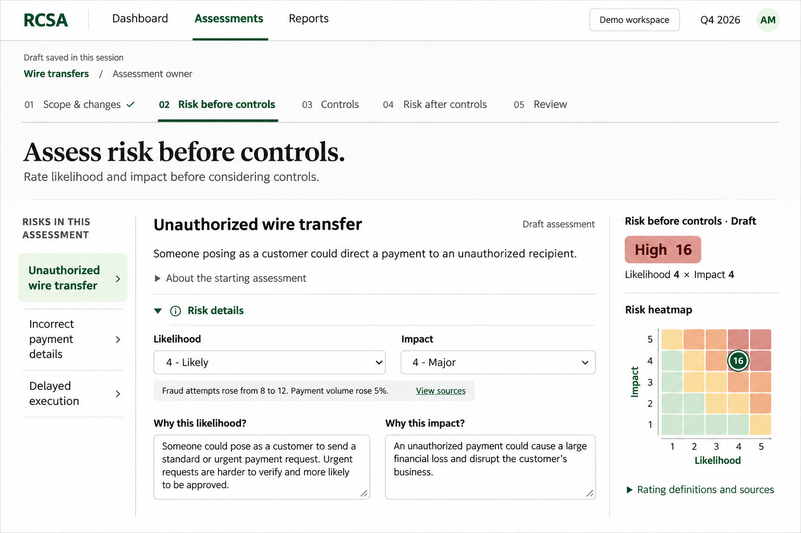
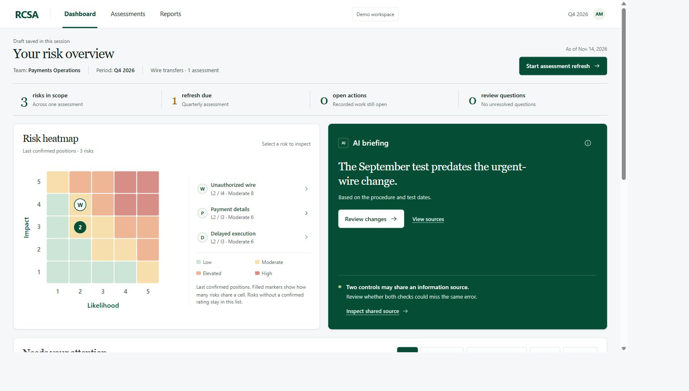
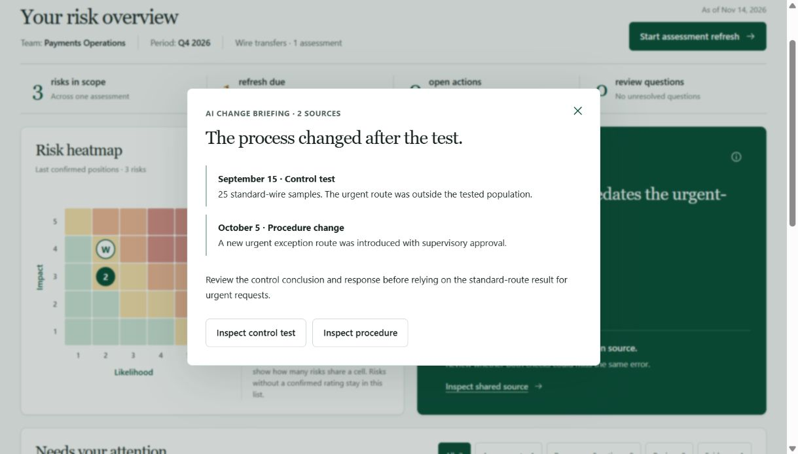
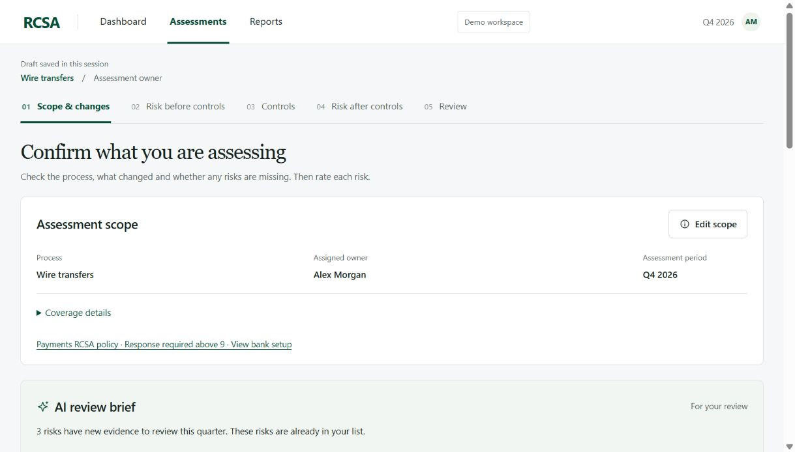
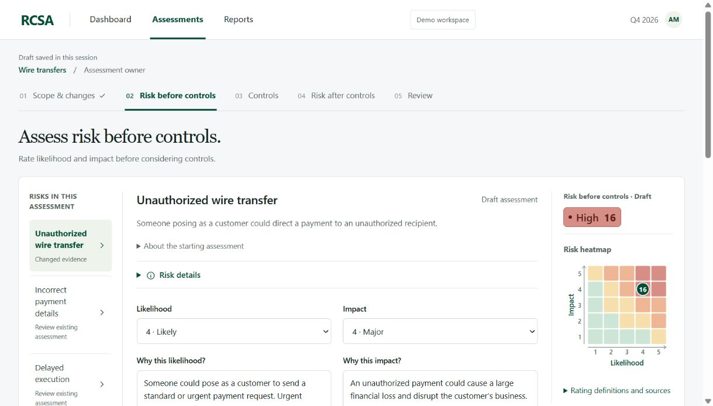
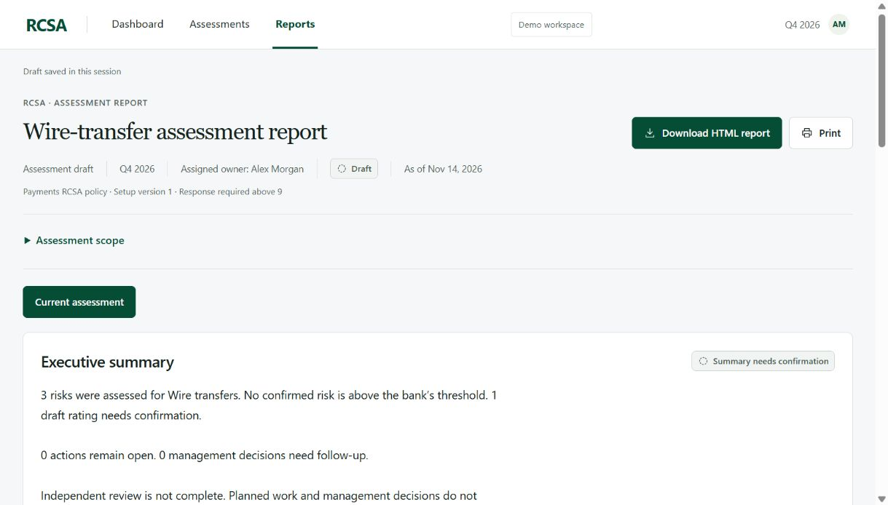
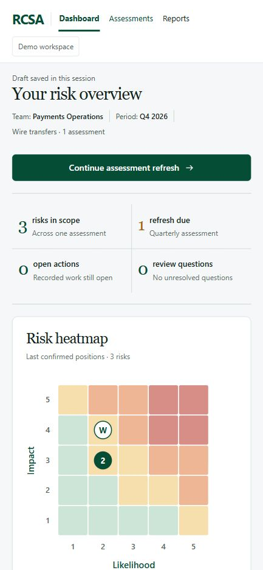

# RCSA demo design review

November 17, 2026 · Local demo · Bank leader first impression

Keep the dashboard useful across assessments, quarters and roles. The design should work equally well on a quiet day. Use the rating workspace as the reference for the rest of the product because it contains the most important recurring elements together: navigation, selected record, editable assessment, source evidence and draft score.

## Recommended visual direction

The study explores type contrast, a more legible risk list, a consistent header and the relationship between fields, evidence and score. Preserve the application's source wording, risk-list status labels, policy-driven matrix colors and exact cell values in implementation. In particular, discard the study's unsupported wording about urgent requests being more likely to be approved.

- **Product frame.** Group workspace, quarter and avatar at the right of the top bar. Use the same left edge for the page title, stage navigation and working surface. Give the save state a consistent position near the record being edited.
- **Type.** Start with a 30–32 px serif page title, 18–20 px sans-serif panel headings, 14–16 px working text and 12–13 px metadata. Give evidence dates, selected risks and chart labels enough contrast to survive screen sharing. Use tabular numerals in comparable score and date columns.
- **Surfaces.** Keep the pale canvas, white working surface and restrained forest green. Group the risk list, form and score in one workspace with internal dividers. Use visible elevation for a source inspector floating above it. Give editable controls a clearer boundary than panel rules.
- **Data visuals.** Use one matrix, drawn from the bank's scoring rules, at dashboard and inspector sizes. Keep the selected position unmistakable. Pair the draft score with its calculation. Give aggregate markers their own count treatment. Continue to label risk bands with words.
- **Interaction.** Use a matching highlight between risk rows and their map cells on hover and keyboard focus. Selecting a risk should hold the working layout steady. Closing evidence should return focus and scroll to the invoking field. When an owner applies an edit, briefly highlight the affected field and show the actual session-save result.

## 1. Dashboard · Strong identity, divided attention

Forest green, serif headings and an understated white workspace give the product a recognizable identity. The introduction spends its largest type on “Your risk overview.” Four metrics, two of them zero, precede the finding. “Start assessment refresh” and “Review changes” compete for the first click.

Keep the dashboard title and the primary assessment action. Align the map and briefing headers and tighten both panels enough to reveal the first queue item on a typical shared laptop screen. Use the existing briefing's supporting line to name the two source records. Derive each briefing from the active assessment.

## 2. Sources · The strongest moment in the demo

The dialog is unusually clear. On September 15, the test covered 25 standard-wire samples. On October 5, the bank introduced an urgent exception route. Those two facts are short enough to show on the dashboard. Keep the original records one click away. A horizontal pair of dated entries on desktop can become a vertical pair on phones. Use text to identify which population was tested.

## 3. Scope · A clear sequence loses the thread of the first click

The five-stage navigation orients the owner. The opening viewport then spends most of its space restating the process, owner and quarter. The AI brief and the inventory repeat the three risk names. At a measured 704 CSS-pixel viewport height, the confirm button began around 2,023 pixels down the page.

Keep the stage title stable. Put process, owner and quarter on one editable line. Link each evidence finding to its named risk so readers can move between the brief and the inventory. Surface progress toward scope confirmation while keeping the explicit owner decision at the end.

## 4. Rating · Good working layout, important evidence arrives late

The left-hand risk list, central editor and score at right are a coherent daily-work layout. Keep them. The owner sees two rating fields and two rationale editors before reaching the observation that fraud attempts rose from 8 to 12 while payment volume rose 5%.

Place that one evidence sentence beside likelihood and keep the full analysis expandable. Keep the proposed and confirmed states explicit. When an owner accepts an edit, briefly highlight the changed field, retain focus and update the draft status. Honor the user's reduced-motion preference. [W3C guidance on interaction animation](https://www.w3.org/WAI/WCAG22/Understanding/animation-from-interactions.html)

## 5. Report · Credible record, slow executive opening

The report names the owner, date and policy threshold. The underlying register distinguishes previous and current confirmed ratings. Its first screen gives more prominence to download, print, scope, version and repeated draft labels than to the conclusion.

Lead with “All three confirmed risks are within threshold. One draft rating awaits confirmation.” Follow it with the named risk, owner and independent-review status. Group export and version controls together. Keep the full register, sources and operational history available below.

## 6. Phone · Readable stacking puts the finding too far down

The first screen gives the metrics and heatmap almost all the space. The briefing headline began around 1,406 CSS pixels down in a 938-pixel-tall responsive viewport. Reorder the dashboard so the finding, dates and action come first. Verify that a reader can explain the evidence gap using words alone and can open and dismiss its sources with a keyboard.

## Product acceptance test

At screen-share size, ask a first-time user to select a risk, explain its draft score, open the supporting record and return to the same field. Repeat with a different risk and a record with no change. Check legibility, keyboard focus, scroll position and correct draft versus confirmed status at each step.

This was an expert walkthrough of the local synthetic owner scenario and draft report in Chrome, including a phone-width layout. Buyer reactions, assistive-technology behavior, frame timing and the full independent-review journey require separate testing.
