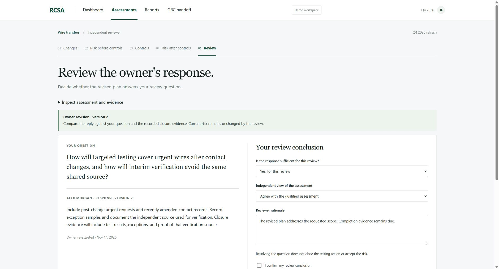
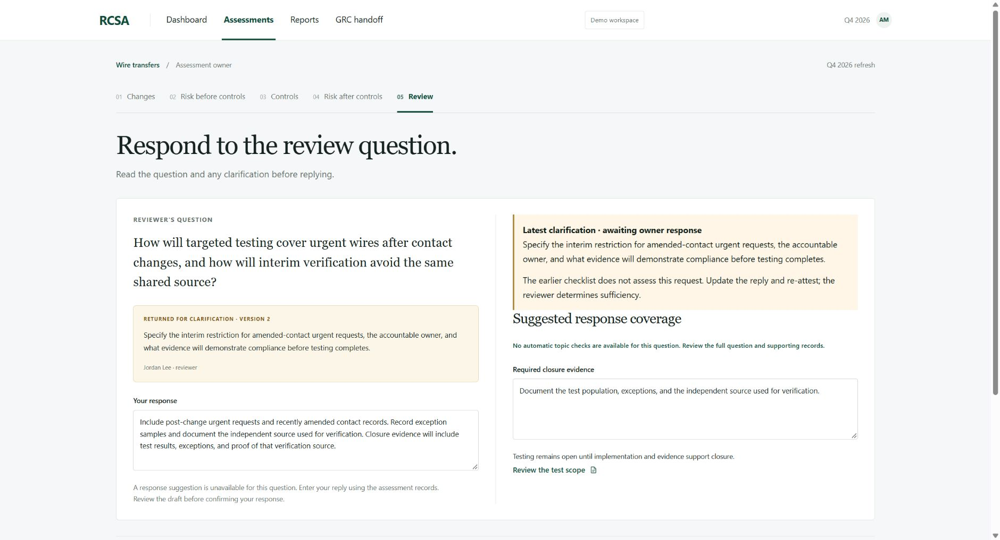
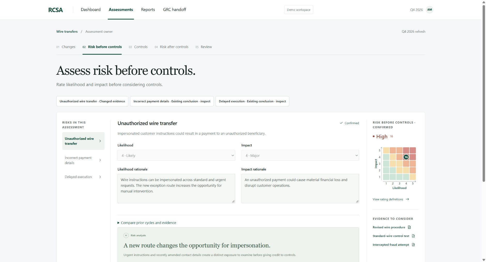

# Independent risk-buyer readiness recheck

November 14, 2026. Read-only product re-review by the fictional large-bank Head of Operational Risk persona. Synthetic test actions took place only in an isolated browser tab. No source edits, shared viewport changes or user-draft changes.

**Result: the targeted returned-clarification issue is fixed in the tested path, and task visibility is materially better. No new blocker was observed in this bounded check.**

1. **Received-response review — improved.** Loaded the Response received scene. “Inspect assessment and evidence” starts collapsed. The original question, owner reply and reviewer decision controls now share the opening view; the evidence summary no longer occupies most of that view. The scene intentionally contains prefilled judgments, which are not evidence of default behaviour in a fresh submission.
2. **Custom return — passed.** Chose Return for clarification, entered the exact request below, attested and recorded the return.
3. **Owner reply after return — passed.** The exact request is retained alongside the original question and existing reply. A visible “Latest clarification · awaiting owner response” notice states that the earlier checklist does not assess this request. DOM checks found **zero** Draft a response buttons and **zero** Mentioned in draft cues. The owner retains the editable response and renewed-attestation path. The old green checklist no longer implies progress against the new clarification.
4. **Task-first assessment — improved.** Inspected Risk before controls. Likelihood, impact and both rationale fields are visible before the collapsed “Compare prior cycles and evidence” disclosure. Risk-review status pills distinguish changed evidence from existing conclusions to inspect. The submitted scene correctly retains read-only fields.

Exact custom clarification:

> Specify the interim restriction for amended-contact urgent requests, the accountable owner, and what evidence will demonstrate compliance before testing completes.

## Buyer interpretation

This resolves the specific cue-alignment concern raised in the earlier simulated buyer review. Suppressing an unsupported suggestion/checklist is more credible than showing irrelevant completion cues. Task-first ordering also makes the reviewer and assessment screens easier to explain without a presenter.

One minor refinement remains optional: the same clarification appears in both the retained return panel and the latest-request notice. Keeping the full text once and using a shorter status notice could reduce repetition without losing accountability. This is not a blocker.

This check supports **readiness for the next buyer conversation and a controlled pilot evaluation of this workflow**. It does not establish overall pilot approval or production readiness. Integration reconciliation, client-methodology mapping, access controls, persistence, performance, AI evaluation and vendor delivery evidence were not tested here. GRC handoff was visible in navigation but outside this recheck's scope. No score for production capability is inferred from this UI fix.

## Current screenshots

Each screenshot was saved and reopened in this run. Browser inventory had changed; the available Chrome browser was used after the previous browser ID was unavailable. No viewport override was applied.

### Reviewer decision visible beside question and reply

### Returned clarification suppresses stale suggestions and cues

### Rating fields before optional history

