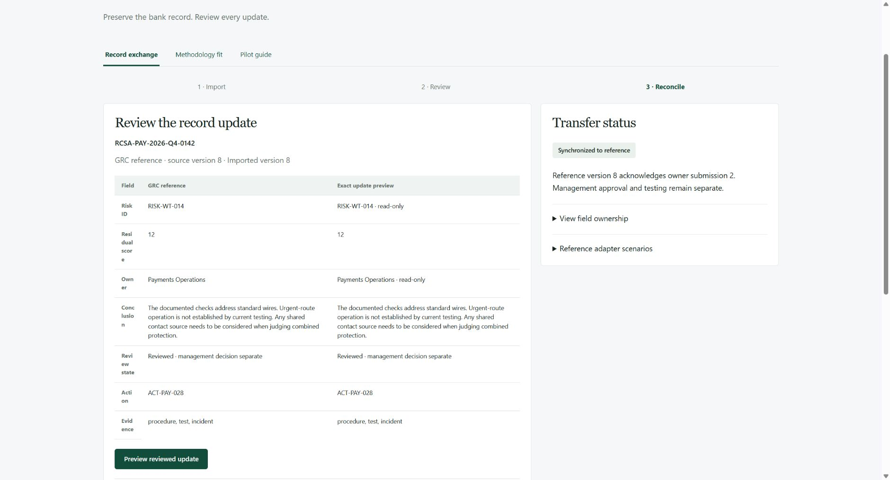
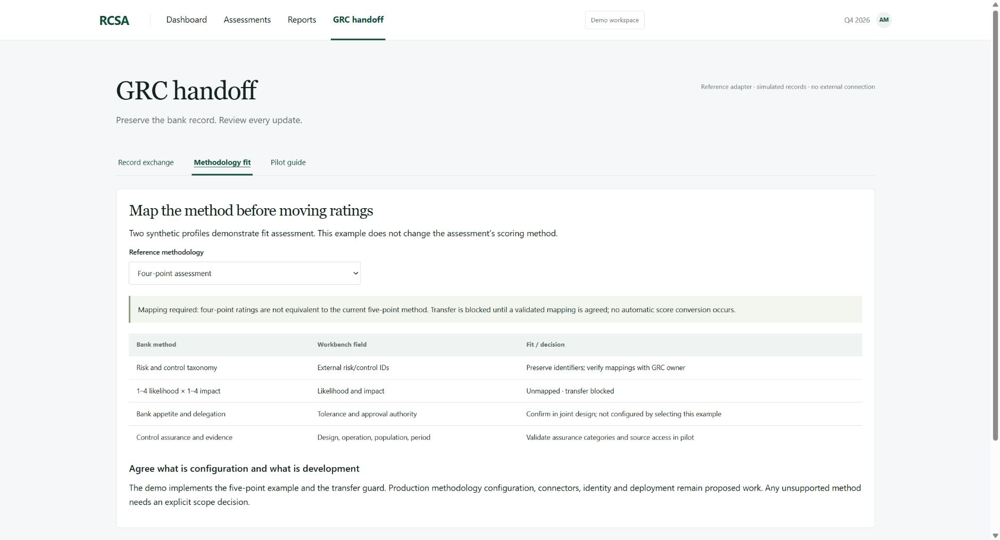

# Technology / procurement recheck

November 14, 2026. Fictional buyer judgment and bounded independent correctness review. Read-only product review; only this report and tech-* screenshots were saved. Browser work used a separate tab; no other agent's application state was changed.

**Updated stance: proceed to joint pilot design, conditional on resolving the concrete ownership defect found during review. That defect was subsequently fixed and the fresh engine reproduction now passes.** The new slice materially improves the alongside-GRC story without pretending that a live bank connector exists. This is enough evidence for a scoped design conversation; it does not establish production integration, authentication or deployment readiness.

## Correctness finding, resolved during review

The first implementation claimed that GRC owned the organizational owner and that bank fields were retained. In-memory reproduction set the reference owner to `Bank GRC Owner` and added `bankOnly='retained field'`, then ran import → preview → authorize → deliver. The owner became `Payments Operations` and the unknown field was dropped. The implementation used a hardcoded owner and replaced the record instead of applying a field allowlist. This was a real contract contradiction, not a limitation of a simulated endpoint.

Reported immediately to the implementing parent. After its correction, a fresh-process module recheck preserved:

```
ownerAfter: Bank GRC Owner
bankOnlyAfter: retained field
actionStatus: In progress
actionMetadata: keep
```

The updated engine preserves source owner, IDs, unknown source metadata and existing action status/metadata while applying reviewed fields. I made no source changes. `node tools/verify-buyer-readiness.mjs` also passed against that revision.

## What was checked

| Step | Evidence / result | Health |
| --- | --- | --- |
| 1. Import in an unreviewed draft | Browser import preserved the assessment; Preview was disabled with a submission/review requirement. | Good |
| 2. Reviewed snapshot | Presenter completed-review scene preserved the imported source baseline; owner context exposed the reviewed version and exact comparison. | Good |
| 3. Attestation → pending → acknowledgment | Browser required explicit owner attestation, showed Pending acknowledgment with unchanged source, then delivered and showed source version 8 acknowledging submission 2. | Good |
| 4. Stale conflict / rebase, transport retry | Engine and passing readiness script: stale version rejected, attested rebase clears old request and requires new authorization; transport retry keeps request ID; duplicate delivery does not increment source. | Good within local adapter scope; not separately replayed in browser |
| 5. Method and mapping guards | Browser four-point profile states transfer blocked without conversion. Engine tests reject incompatible method and unmapped controls, second-line transfer, and a pending update after owner revision. | Good |
| 6. Bank-owned fields | Initial reproduction exposed overwrite/drop defect; fresh regression after parent's fix preserves owner, unknown fields and action metadata. | Resolved by parent; fresh engine result verified |

## Buyer interpretation

- The visible system boundary, external IDs and separate authorization/acknowledgment states now answer a substantial part of the earlier GRC objection. Keeping management approval and testing separate is consistent across assessment and transfer.
- Methodology fit honestly distinguishes a compatible five-point example from an incompatible four-point example. It does not claim that selecting a profile configures the whole product.
- The pilot guide specifies bank/vendor roles, design/prove/decide gates, measurable outcomes and temporary-resource exit. It explicitly says named people, dates, production controls and service commitments remain to agree. This improves delivery credibility without fabricated credentials.
- “Reference adapter · simulated records · no external connection” is clear in the reviewed UI. No live-connector claim was observed. Pilot text also names the absent live GRC, SSO and model services.

Evidence-based confidence moves **GRC fit 2 → 3/5** and **implementation confidence 2 → 3/5**: promising with material gaps. Other scores remain unchanged from the earlier bounded review. The improvement is in demonstrated integration design and implementation discipline, not proof of a production connector.

## Remaining polish notes sent to parent

1. After acknowledgment, the old preview/attestation remained visible with source version 7 even while the status acknowledged version 8. Reauthorization was idempotently refused, so this was not an overwrite defect. Clear the old preview or hide authorization once the same payload is acknowledged.
2. In tech-ack.jpg the first table column is too narrow: Owner, Conclusion and Residual score wrap across multiple lines on desktop. Give field labels a minimum width; the methodology table is much more readable.

The parent subsequently reported clearing the acknowledged preview, blocking duplicate preview with an already-synchronized message, and giving field labels a minimum width in a contained table. Those final visual corrections were not independently recaptured here; tech-* screenshots show the preceding state. No other concrete integrity blocker was established in this short check. Production permissions, live adapter behavior and arbitrary upstream schemas remain unverified.

## Screenshots

### Browser acknowledgment


### Methodology guard


The screenshots were saved and reopened from disk. No screen-reader, contrast, responsive matrix, load, security or live-network integration certification is implied. The successful engine guards are evidence about this local reference implementation only.
