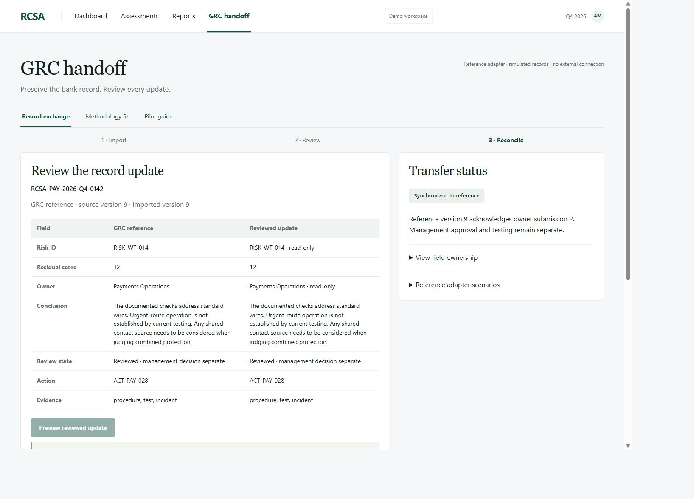
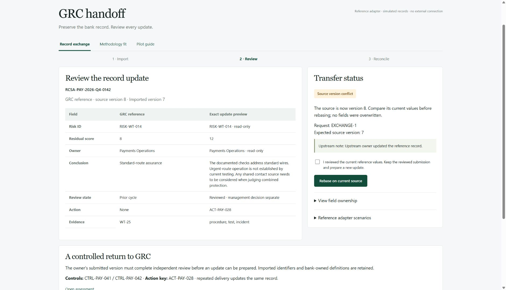
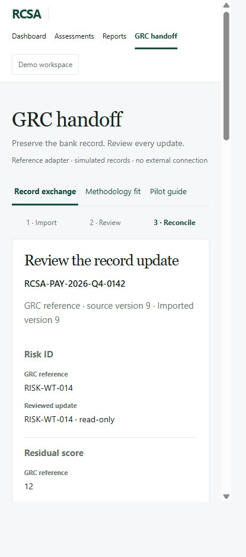
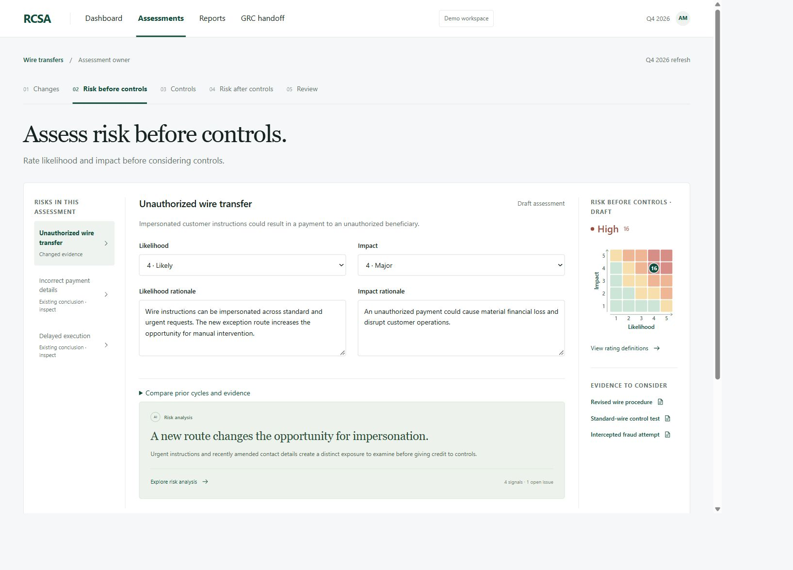

# Buyer readiness: implementation and verification

Implemented locally November 14, 2026. [Plan](../../docs/operations/buyer-readiness-plan.md), [adapter contract](../../docs/data-contracts/grc-reference-exchange.md), [pilot working brief](pilot-working-brief.txt).

## Result

- GRC handoff is an interactive local reference-adapter workspace with Record exchange, Methodology fit and Pilot guide tabs. It demonstrates one assessment's stable external identifiers, field ownership, reviewed-snapshot preview, explicit owner authorization, pending delivery, acknowledgment, conflict/rebase and safe retry. No external GRC or bank service is contacted.
- Bank-owned owner/IDs, unknown reference metadata and existing action status/metadata are preserved by an allowlisted patch. The action uses a stable upsert key. A reviewed submission cannot be sent twice. An owner revision invalidates a pending update. Unmapped controls and incompatible methodology block transfer.
- Rating fields and rationales precede expandable history; current control names/conclusion precede optional relationship diagrams and AI assistance. Existing/changed risk context appears in the risk selector, without a second duplicate selector. Reviewer context is expandable before the decision panel.
- Returned clarification is shown explicitly unresolved. Original automatic suggestions and topic cues are suppressed for that return; the owner must respond and re-attest for reviewer judgment. This is a safe bounded fallback, not general semantic analysis.
- Five-point and incompatible four-point examples make fit decisions visible without translating ratings. The pilot guide explains proposed roles, decisions, acceptance and exit. A working downloadable brief contains no invented staff, certifications or production commitments.

## Checks

Eleven scripts passed: `verify-buyer-readiness`, `verify-demo`, `verify-copy-authenticity`, `verify-control-assistance`, `verify-control-assistance-workflow`, `verify-product-refinements`, `verify-owner-revision`, `verify-risk-intelligence`, `verify-risk-matrix`, `verify-ux-navigation`, and `verify-persona-fixes` (all `.mjs`). Relevant buyer/demo/navigation checks were repeated after final refinements. The old persona assertion expecting green cues after a return was updated to require no old green cues and the unresolved clarification instead. App/adapter/view syntax and `git diff --check` passed.

The new state-machine checks cover import without overwriting local assessments; immutable reviewed submissions; attestation; first/second-line roles; incompatible method and unmapped control guards; no premature reference mutation; pending/acknowledgment separation; failed transport; same-ID retry; duplicate delivery; stale-version rejection; explicit rebase and renewed authorization; revision invalidation; bank-owned field preservation; and latest-clarification fallback.

Browser verification used the existing tab-level browser control surface. The main sequence was import at source version 7 → reviewed presenter scene → owner perspective → exact preview → authorize EXCHANGE-1 → stale source conflict at version 8 → explicit rebase → fresh preview/authorization EXCHANGE-2 → transport failure → acknowledgment on retry → reference version 9. No source mutation occurred on either failure. The acknowledgment clears the old preview/authorization and displays the already-synchronized guard. The same action ID remains visible on both sides.

Methodology selection displayed the unmapped four-point guard and was restored to five-point. Pilot guide download succeeded; the downloaded file in Downloads was compared byte-for-byte with `pilotText()` and copied into this evidence folder. The browser download-event waiter timed out despite the file downloading correctly; that tool observation is not reported as an app failure.

Main browser captures exercised actual adapter actions. Prepared scenes accelerated the reviewed assessment state, so this is not a claim that every owner/reviewer step was replayed from scratch in the same tab. The normal editable owner scope → inherent → controls path was also checked. Optional AI assistance remained reachable.

## Independent rechecks

[Risk recheck](risk-recheck.md): the reviewer directly returned custom feedback. Exact wording remained visible, zero old topic cues and zero automatic draft buttons were present, and decision fields appeared before history. No new blocker in that bounded path.

[Technology recheck](technology-recheck.md): independently reproduced an ownership bug in the initial adapter. Delivery originally replaced the record. The correction now patches allowlisted fields; a fresh regression confirms source owner, unknown bank fields, action status and action metadata survive. The reviewer reported two additional visual/state issues, also corrected: stale authorization after acknowledgment and excessively narrow field labels. Parent browser verification recaptured those final corrections.

The fictional technology buyer's stance advanced to joint pilot design, with demonstrated integration/delivery confidence 3/5 rather than 2/5. This is simulated expert feedback, not actual customer approval or proof of production readiness.

## Design comparison and deviations

The generated [GRC handoff reference](../../docs/ux/concepts/buyer-readiness/grc-handoff.png) was created with the built-in image tool using the existing leadership report as the style reference. It was inspected with `view_image` before implementation and again alongside the latest desktop screenshot. The image remains a design reference; application controls and text are native HTML/CSS/ES modules.

Desktop was checked at the concept's native **1488 × 1058 CSS pixels**. Browser zoom required a 1339 × 952 viewport request to reach that measured CSS size. Narrow verification measured **390 × 844**, with document width 373; no document-wide horizontal overflow was observed. The temporary override was reset and a fresh normal-size handoff preview was left open.

| Comparison point | Implementation / disposition |
| --- | --- |
| Palette and surfaces | Existing pale cool-grey canvas, white sheets, forest-green actions, charcoal text and thin borders retained |
| Typography | Existing serif headings and sans-serif controls retained; readable comparison text; first-column wrapping fixed |
| Layout | Same header, three direct tabs, numbered progress, record/status columns, return explanation and exchange history |
| Data and copy | Intentional deviation: actual reviewed/draft/reference values replace illustrative fixed scores; no invented successful import or event timestamp before interaction |
| Controls | Import, preview, authorize, pending delivery, conflict/rebase and retry are real local state transitions; successful acknowledgment removes stale authorization |
| History | Events are produced by interactions; the concept's invented prefilled event is not used. History remains expandable |
| Mobile | Intentional adaptation: paired labelled reference/update fields stack instead of forcing a wide comparison table; navigation wraps and controls remain usable |
| Above-fold copy | Product name, GRC handoff title, subtitle, simulation statement and three tabs match the reference. Actual state labels and long conclusions are required operational differences |

The implementation was visually verified against the adopted reference and existing design system with these explicit functional/mobile adaptations. No remaining material visual mismatch was identified in the checked surfaces; this does not assert pixel identity across untested states.

## Evidence

Additional numbered screenshots cover initial import, failed transport, methodology mismatch and current controls. The two independent reports include their own captures. Some first screenshot requests timed out or reflected resizing; only successful inspected replacements are retained as final numbered evidence.

## Boundaries and closeout

No live connector, real SSO, production model, general method configurator, deployment or customer data was introduced. This demo supports a concrete buyer working session and pilot design; a real bank implementation still needs the agreed connector, architecture, authorization, data-handling and operating proof. Existing unrelated workspace changes were preserved. No external communication or production action occurred. Temporary implementation script removed; design reference, screenshots and recheck reports are retained as requested reviewable evidence. The local preview server was restarted when the previous process stopped during final refresh.
