# RCSA demo — copy authenticity review

November 14, 2026. Follow-up to the CX, UX and UI audit. Reviewed the running local app in a separate browser tab and traced the relevant strings to their current source. No product source or data files were changed. Temporary text edits and a challenge submission affected only the isolated demo tab.

## Verdict

The concern is substantiated. Several screens expose how the demonstration was constructed. More broadly, the product often speaks like a facilitator explaining a case study: a prepared comparison, a lesson about evidence, and the conclusion the audience is supposed to reach. That voice makes the experience feel staged even when the workflow is functional.

The highest-impact issue is that some displayed text still follows the original scenario after the user edits the record. A copy pass will improve the first impression, but these contradictions also need to be resolved.

Recommended voice: describe the current record, relevant finding, evidence gap and available action. Use short operational language. Retain uncertainty where the evidence is uncertain. Keep a clear workspace-level disclosure that records are synthetic and AI interactions are simulated; place implementation explanations in demo information and presenter tools. Specific feature limitations must remain visible at the affected action.

## Highest-priority findings

### 1. Construction notes appear inside source evidence

In the Q1 assessment record, Scope says “Prepared prior-cycle wire-transfer assessment,” and the excerpt says the authored records provide the “presentation baseline” rather than institutional history. The same sentence exists for Q2 and Q3. These words belong to demo documentation, not to the body of a simulated assessment record. Evidence 03.

Replace the scope with “Wire transfers · Q1 2026 · 5-point risk assessment.” Retain the recorded scores in the excerpt and remove the editorial sentence about constructing the presentation. Keep sample-record provenance in workspace/source metadata so the record is still clearly synthetic.

The separate Q3 “Prior assessment” source is already much stronger: it gives a period, approved status, scope and recorded rationale without narrating the demo. Evidence 02. Use that pattern consistently.

Source: `assets/data/assessment-context.json:126` and the corresponding Q2/Q3 entries.

### 2. The checker validates familiar wording rather than the same meaning

The default conclusion produces “The prepared wording retains the evidence qualification.” Its footer explains that arbitrary wording is not evaluated by a live model. After changing the conclusion to “Standard-wire testing does not cover the urgent route. Review of source independence is still pending,” the result becomes “The draft does not match a prepared claim check.” It suggests the original wording again. Evidence 08–09.

This behavior is a stronger signal of scripting than any label. Replacing the result with “Your conclusion is supported” would overstate what was checked.

For the current implementation, narrow the promise to “Review evidence coverage” and present a factual checklist of test population, route, period and information-source independence, with sources for the owner to inspect. If a bounded automatic check is retained, name the specific checks it actually performs and use “Automatic review unavailable for this wording” when unsupported. Keep the explanation of the simulation available at the point of use.

If the intended feature is genuinely to evaluate arbitrary conclusions, implementing that capability is separate work. A neutral successful review should describe which claim matched which evidence, rather than praising the use of prepared wording.

Source: `src/scripts/demo/control-assistance.js:132`, `:133`, `:136`; `control-assistance-view.js:51`, `:111`.

### 3. Edited questions still produce the original reply and coverage cues

In the submitted scene, I changed the reviewer question to “Who owns the November 28 testing action?” The owner screen showed that exact question. Draft a response then inserted the standard paragraph about urgent requests, amended contact records, independent sources and closure evidence. It did not name the action owner. All four fixed coverage cues changed to “Mentioned in draft.” Evidence 12.

The cues accurately describe mentions, but they no longer describe what this question asks. Their disclaimer does not repair that relevance problem.

Drafts and coverage cues should follow the actual question, current action and record. Until that behavior exists, do not offer the canned text as a response to an arbitrary edited question. Offer a clearly named reference such as “View test-scope response example,” or make the prepared suggestion unavailable when it no longer applies and leave the reply editor available. Remove the seeded poor reply from the live editor; place instructional examples in a separate walkthrough if needed.

For this specific ownership question, the answer should use the actual stored action owner. Do not invent a named individual if the record only assigns a team.

“Use a shorter draft” is especially misleading: source inspection shows it restores the fixed “Staff have been reminded of the callback procedure” sentence. That is not a shorter version of the current reply. Remove the control or implement actual shortening with a reviewable preview.

Source: `src/scripts/demo/app.js:169`, `model.js:71`, `assessment.js:99`; `assets/data/workflow-demo.json:245`.

### 4. Audit-history summaries describe the script rather than the recorded action

The edited ownership question was stored correctly in Read recorded text. However, its history summary still said “Raised a review question about test scope and the shared contact source.” Evidence 11.

Use the safe event label “Sent a review question” and show the actual text beneath it. If topic summaries are added later, derive them from the recorded question and verify them. Audit history should not introduce a topic that the user did not record.

Source: `src/scripts/demo/model.js:69`.

### 5. Research scope is not conditional on the current evidence state

In the initial workspace, before using the New evidence received scene, Research said the records reviewed included “the service-owner clarification.” The research renderer emits this statement unconditionally. Evidence 07.

Build that list from the evidence actually available in the current version, with clear record links. Show the service reply only after it becomes available. If the pack intentionally includes material beyond the assessment's current evidence, label that availability explicitly instead of implying it has already been reviewed.

Source: `src/scripts/demo/research.js:13`.

## Replacement-copy inventory

These are proposed replacements, not implemented changes. Conditional examples must use actual state and recorded values. “Prepared” is not inherently wrong—an assessment can be prepared by a person—but repeated use without an actor, status or date makes these screens sound prewritten.

| Location / evidence | Current wording | Proposed wording or treatment | Work needed |
| --- | --- | --- | --- |
| Historical source / 03 | “Prepared prior-cycle wire-transfer assessment; same five-point method and process boundary” | “Wire transfers · Q1 2026 · 5-point risk assessment” | Copy; preserve sample provenance separately |
| Historical excerpt / 03 | “These authored prior-cycle records provide the presentation baseline…” | Remove the construction sentence from the record excerpt; retain its recorded ratings and workspace disclosure | Copy / metadata placement |
| Response subtitle / 04 | “Review the prepared plan. Adjust what matters.” | Before creation: “Choose a response and assign the follow-up.” After creation: “Review the response and linked action.” | State-aware copy |
| Response empty state / 04 | “The draft brings the rationale, protective measure and evidence into three review sections.” | “Select an approach to add the rationale, owner and follow-up.” | Copy; verify fields revealed by selection |
| Options label / 05 | “Prepared option comparison” | “Control options” | Copy |
| Options heading / 05 | “Address the cause. Then demonstrate the protection.” | “Compare coverage and validation requirements” | Copy |
| Options footer / 05 | “No option is automatically selected. Planned measures do not reduce the current rating.” | “No response selected.” Use a separate status, when relevant: “Risk rating unchanged · implementation pending.” | State-aware status |
| Assessment check label / 06 | “Prepared review · Unauthorized wire transfer” | “Evidence review · Unauthorized wire transfer” | Copy |
| Assessment check heading / 06 | “How does the conclusion hold up?” | “Control conclusion and supporting evidence” | Copy; avoid implying arbitrary semantic analysis |
| Assessment check / 06 | Quoted “Two checks provide independent protection.” | Label as a review question: “Do the controls use independent verification sources?” Do not present it as the owner's claim unless the owner actually wrote it | Content / attribution |
| Research heading / 07 | “Relevant findings, with their boundaries.” | “Research findings” with a “Coverage and limitations” disclosure | Copy / hierarchy |
| Research introduction / 07 | “Records reviewed: … and the service-owner clarification.” | List the actual available record titles and IDs, linked to their version/date | State / evidence provenance |
| Coverage finding / 08–09 background | “The operating-evidence boundary remains” | “Urgent-route testing is outstanding” | Copy |
| Checker label / 08 | “Within the prepared evidence scope” | Name the real check performed, or use “Evidence coverage” for a manual review aid | Capability scope |
| Checker success / 08 | “The prepared wording retains the evidence qualification” | A factual check result about named claims and sources, only if evaluated; otherwise a manual evidence checklist | Behavior, then copy |
| Checker unsupported / 09 | “The draft does not match a prepared claim check.” | “Automatic review is unavailable for this wording. Review the linked sources.” | Copy; retain functional limitation |
| Reviewer label / 10 | “AI · review prepared” | “AI review brief” within the clearly disclosed simulated-AI workspace | Copy |
| Reviewer heading / 10 | “One conclusion deserves a closer look.” | “Urgent-route protection needs clarification” when supported by the current evidence | State-aware finding |
| Reviewer form heading / 10 | “A focused review question” | “Question for the assessment owner” | Copy; current field label already works |
| Decision history / 11 | “Raised a review question about test scope and the shared contact source.” | “Sent a review question” followed by the actual question | Behavior / event text |
| Reply editor / 12 | “Staff have been reminded of the callback procedure.” prefilled | Empty reply with “Enter your response” guidance; keep illustrative poor/good replies in walkthrough material | Initial-state content |
| Reply control / 12 | “Use a shorter draft” | Remove until it shortens the current reply; a named response example is an honest alternative | Behavior |
| Reply coverage / 12 | Fixed four-topic checklist regardless of the question | Derive relevant topics from the current question, or explicitly label a fixed checklist “Test-scope reference checklist” | Behavior / scope |

## Voice and information placement

### Use operational facts

Prefer “Urgent-route testing is outstanding” to “The operating-evidence boundary remains.” Prefer “Review question sent · awaiting owner response” to “A focused question is with the owner.” These communicate an actual state with less ceremony.

Keep the named risk, period, owner, version and source close to the statement they qualify. A real platform's credibility comes from accurate context and consistent state, not from adding more IDs, invented timestamps, artificial loading animations or fake activity.

### Reduce repeated instruction

The app repeatedly explains that humans judge sufficiency, that planned actions do not lower current risk, and that the test only supports its sampled population. Those are useful distinctions. Repeating them as teaching paragraphs on most screens makes the product sound like a training exercise.

State the rule at the action where it matters and express its consequences through statuses: Proposed, Not tested, Awaiting owner review, Testing open, Management decision pending. Keep the fuller method explanation accessible through help. Do not remove an evidence limitation that changes the meaning of a source or conclusion.

### Keep source facts separate from interpretation

Source excerpts should read like the underlying record; AI findings should identify the inference and cite the excerpt; human conclusions should be attributed to their author. Some current source text mixes the record with an instructional lesson about what the reader must not infer. Preserve real scope limits, but move platform interpretation outside the quoted record.

Do not rewrite a public-source quotation or invent approved status, ingestion history, a completed review or a new source to create realism. The proposed historical replacement above only reformats scope and removes construction commentary; it does not add an approval claim.

### Make simulation clear without narrating construction throughout the workflow

Suggested persistent workspace badge: “Demo workspace.” Its adjacent information panel should say: “Synthetic records. AI suggestions and incoming replies are simulated. Changes remain in this browser session.”

Presenter controls can retain scene names, reset tools and fuller setup details. Product records can then use realistic operational language without repeatedly saying “authored,” “prepared,” “this example” and “presentation baseline.”

Feature-level limitations still belong beside their controls. A simulated or bounded checker must not be relabelled as a general conclusion validator. Research built from a fixed reference pack must not claim live search. No change to actual capabilities is implied by a copy edit.

## Recommended implementation order

1. Correct history summaries, question/reply mismatches and evidence-availability claims. These contradict visible user actions.
2. Narrow or implement the checker and reply-assistance promises. Keep the general reply editor available for unsupported cases.
3. Remove construction commentary from source bodies and normal workflow copy; provide coherent workspace-level simulation information.
4. Replace narrative headings and repeated teaching prose with findings, statuses and concise actions.
5. Recheck both the original walkthrough and edited-input paths. Include an ownership-only question, a paraphrased conclusion, a changed control set and a new-evidence revision. Do not limit review to the original script.

## Capture log and general health

| Evidence | Step | Copy health |
| --- | --- | --- |
| 01 | Dashboard | Mostly credible; specific briefing and task context |
| 02 | Prior-assessment source | Good record voice; useful reference pattern |
| 03 | Q1 history source | Explicit presentation-construction commentary |
| 04 | Response creation | Prepared-plan and layout narration |
| 05 | Response options | Prepared label and instructional headline |
| 06 | Assessment check | Prepared review, scripted claim framing |
| 07 | Research | Static research-scope claim |
| 08 | Default conclusion check | Explicit prepared-wording validation |
| 09 | Paraphrased conclusion check | Exposes finite claim matching |
| 10 | Reviewer workspace | Understandable task; staged framing |
| 11 | Edited-question history | Summary contradicts actual question topic |
| 12 | Reply to edited question | Original script and irrelevant fixed topic cues |

## Screenshot evidence

### 01 — Dashboard
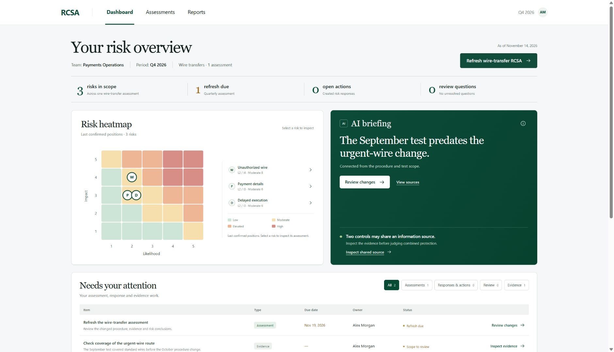

### 02 — Prior assessment: credible record voice
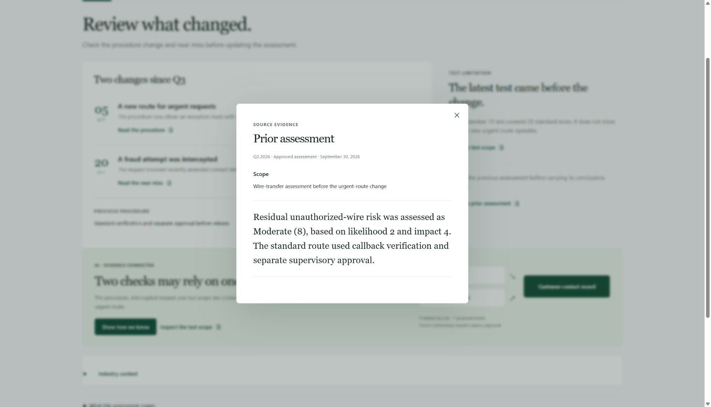

### 03 — Q1 record: presentation commentary in evidence
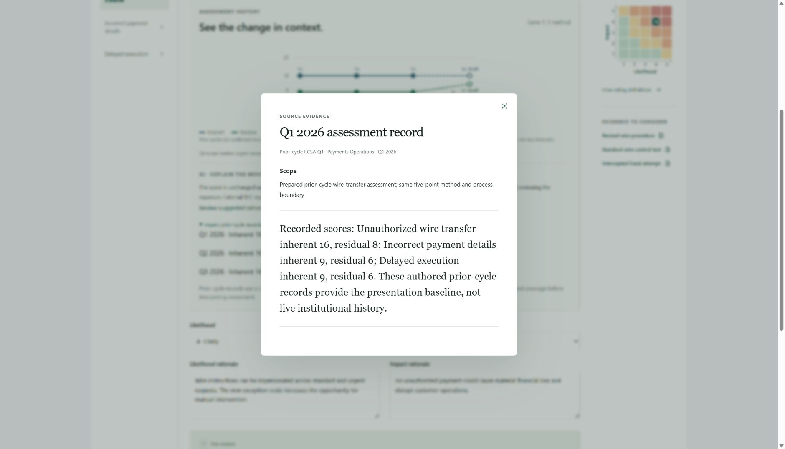

### 04 — Response: prepared plan and layout narration
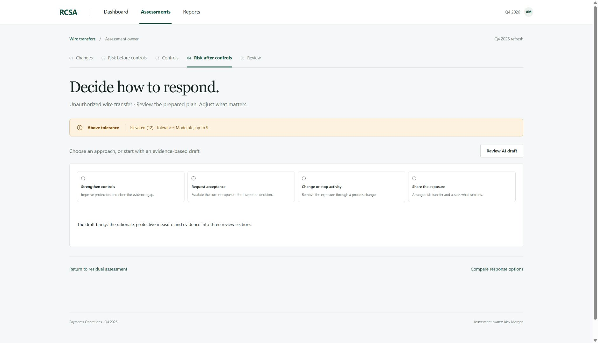

### 05 — Options: staged framing
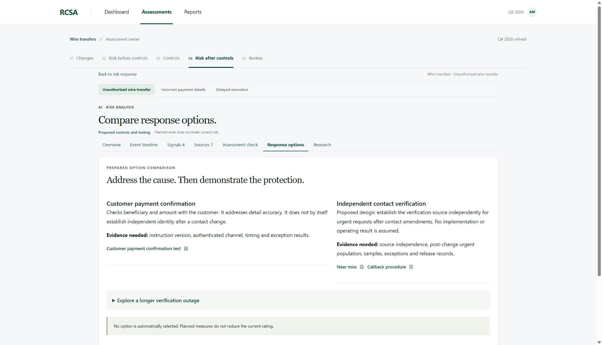

### 06 — Assessment check: prepared review
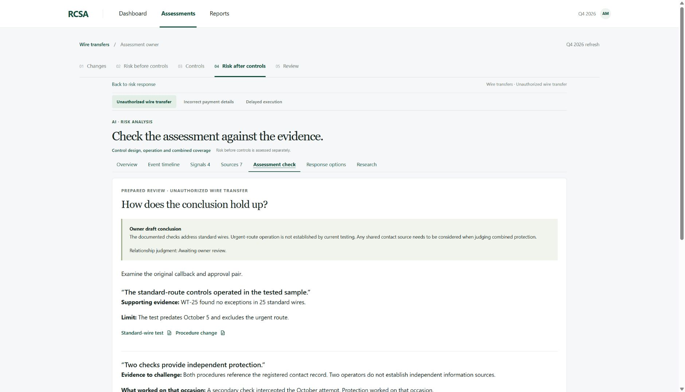

### 07 — Research: scope claim
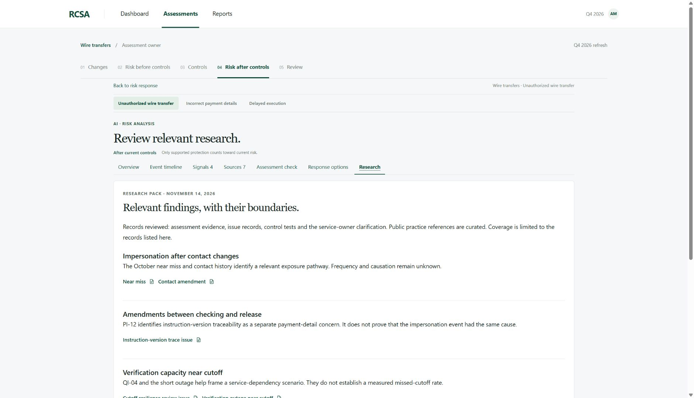

### 08 — Default conclusion check
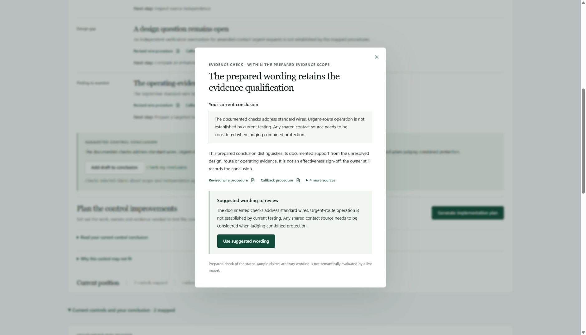

### 09 — Edited conclusion check
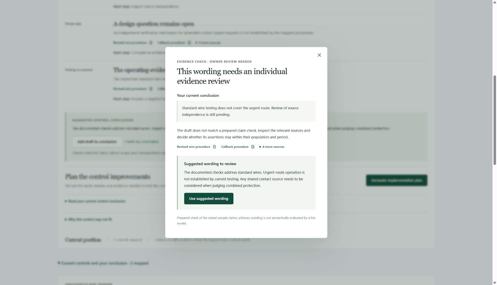

### 10 — Reviewer workspace
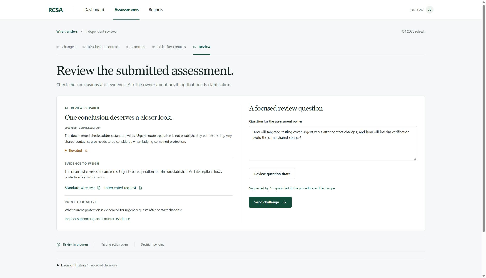

### 11 — Edited question: mismatched history summary
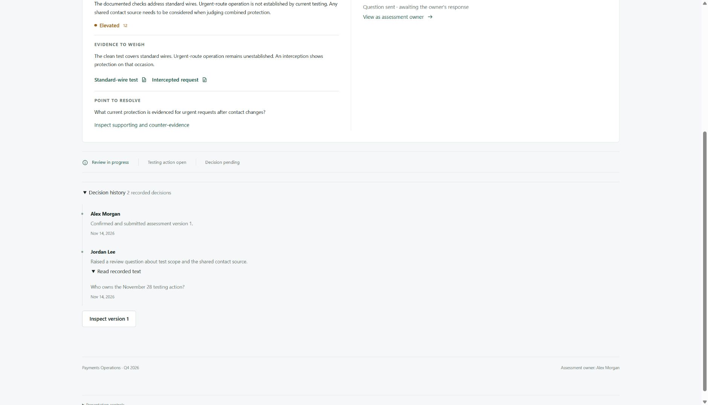

### 12 — Edited question: mismatched reply draft
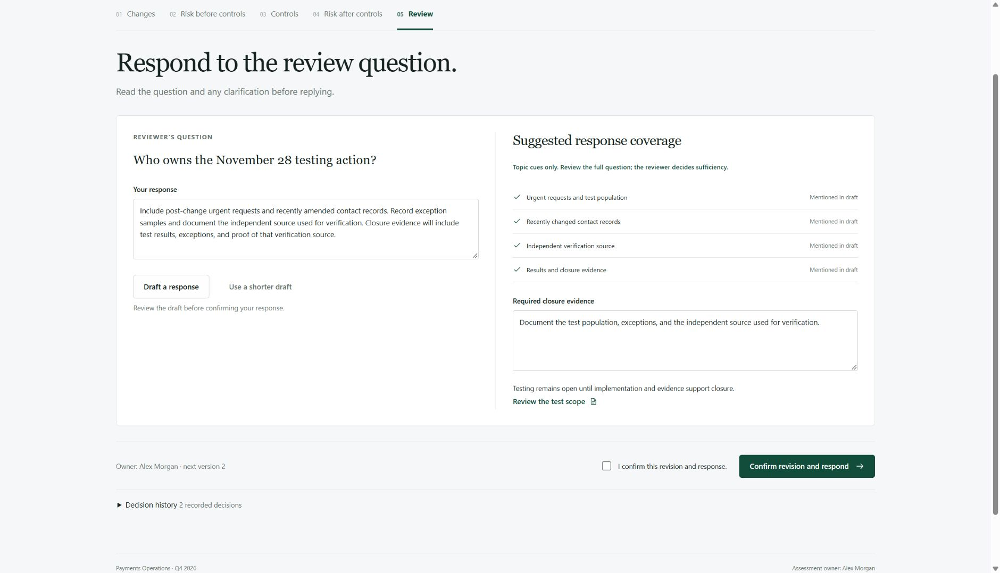

## Limits

This is a copy and interaction-authenticity inspection, not a full feature regression or user study. The twelve screenshots were captured and reopened in this run. The first attempted capture for evidence 09 showed the background rather than the dialog; it was rejected and replaced with the correct state. No external public links were opened and their contents were not verified. Source findings are restricted to the current entry point and relevant rendering paths; legacy shells and unused wrappers were not treated as observed UI. All proposed replacements require normal implementation and verification before they can be called fixed.
